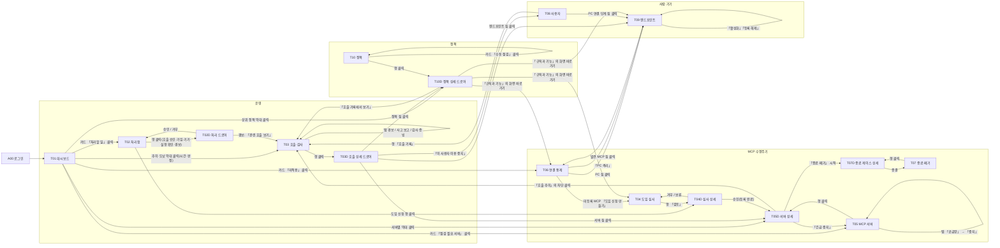
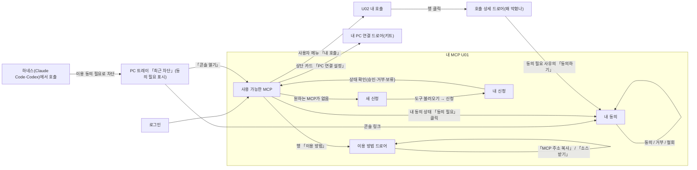
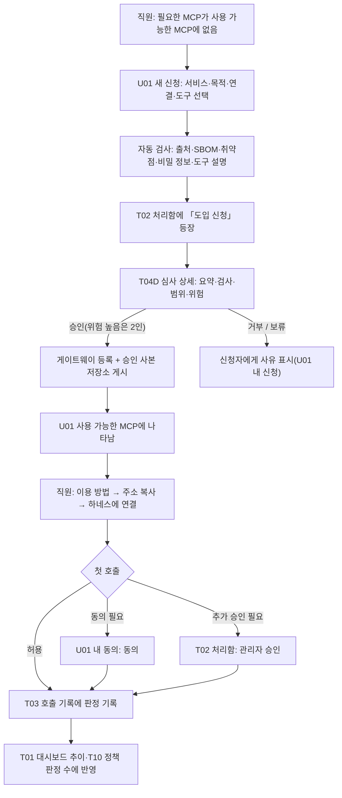
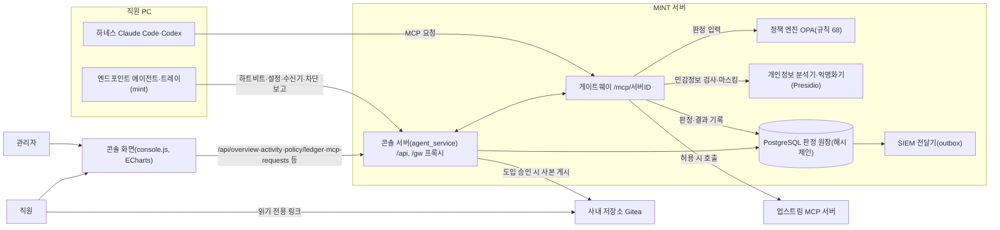
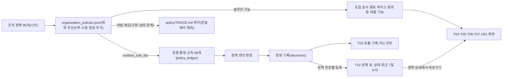

# MINT 관리 콘솔 정보 구조·UX 재설계안

작성 2026-11-14 · 설계 문서(코드 변경 없음) · 대상: 관리자(root·admin)·직원(employee, 협력사 직원 포함)

기준 자료
- 콘솔 코드: `Team-AGI/mcp-gateway` main `3c19a3a4`(2026-11-14 새로 받음). 근거 표기는 이 문서 안에만 둔다.
  - `C:` = `full_stack_lab/gateway/app/agent_static/console.js` (행 번호)
  - `CSS:` = 같은 폴더 `console.css`, `CH:` = `charts.mjs`, `CS:` = `console-state.mjs`
  - `AS:` = `full_stack_lab/gateway/app/agent_service.py`, `GW:` = 같은 폴더 `main.py`
- 정책 자료: `policy/source/sheet.json`(조직 정책 90개 원문, 시트 20261101-0445), `policy/source/classification.json`(개발 현황 분류, 기준 `main 1d22361` 2026-10-27), `full_stack_lab/opa/policy_ledger.json`(운영 통제 규칙 68개), `full_stack_lab/gateway/app/organization_policies.json`(콘솔이 읽는 정책 90개).
- 화면 ID: 현재(As-Is) 관리자 `A01…`·직원 `E01…`·서랍(드로어) `D01…`, 개편(To-Be) 관리자 `T01…`·직원 `U01…`·서랍 `T05D`처럼 화면 ID 뒤 `D`.

## 0. 한눈에 보기

소유자 지적 6개에 대한 판정(근거는 1.5절).

| # | 지적 | 판정 | 개편 방향 |
|---|---|---|---|
| 1 | 정책 화면의 「구현 상태」「한계(pac.py:319)」는 개발 메모 | 맞다. 두 열은 `classification.json`의 개발 판정(10-27 기준)을 그대로 보여 준다. 정책 이름 열도 `MCP Server`·`Tool / Resource` 같은 대상 유형이라 90행이 거의 같은 글자다 | 개발 메모는 콘솔에서 빼고 `policy/TRACE.md`·위키로. 정책 화면은 「운영 규칙 연결·최근 판정 건수·모드·예외」 중심으로 다시 만든다(5.3) |
| 2 | 「위치 심사」 빼라 | 입력 창이 3곳에 있다(서버 상세 버튼, 도입 승인 창 입력 5칸, 호출 승인 서랍 탭) | 3곳 모두 삭제. 운영 규칙 `P-RESIDENCY-001·002`는 입력이 없으면 어떻게 판정하는지 결정이 필요하다(5.6) |
| 3 | 대시보드가 전부 표이고 그래프 없음, 여백 큼 | 맞다. 대시보드 `charts: {}`(C:900). 그런데 `/api/overview`는 시간대별 시리즈·상위 정책·서버별 호출·흐름(sankey용)을 이미 내려 준다. 안 그리고 있을 뿐이다. 본문 15.75px·행간 1.78, 표 행 약 52px | 기존 데이터로 차트 6종, 간격·행 높이 표준 재정의(5.2·8절) |
| 4 | 「보안 관제」는 보고할 게 없음 | 맞다. 숫자 4개짜리 탭 하나(SIEM 미전달·재시도·최장 대기·최근 성공)와 사고 보고, 경보 목록이다. SIEM 주소가 설정돼 있는지, 안 됐을 때 무엇을 해야 하는지가 없다 | 메뉴 삭제. 경보·사고 보고는 「호출·감사」로, SIEM은 감사 증빙 탭의 한 줄 상태로(5.4) |
| 5 | 「도구 이용 동의」를 따로 둔 이유 모름 | 이유는 있으나 위치가 틀렸다. 동의는 직원 본인만 결정한다(AS:2738 「본인 것만」). 관리자가 열면 관리자 본인의 동의만 보인다 | 관리자 메뉴에서 삭제, 직원 화면 「내 MCP」 안으로 합침(5.5) |
| 6 | 사내 저장소(Gitea)는 링크 처리만 | 사이드바 「바로가기」 최상위 링크, 도입 목록 행 링크, 승인된 MCP 소스 받기 3곳 | 사이드바에서 빼고 상황별 링크로 옮김(5.7) |

개편 요약은 5.1절 표(남김·합침·삭제)에 있다.

---

## 1. 현재 화면 목록(As-Is)

### 1.1 공통 구조

| 항목 | 내용 | 근거 |
|---|---|---|
| 접근 | 관리자 10개 화면(`overview, activity, security, servers, people, endpoints, policy, intake, termination, consent`), 직원·협력사 3개(`activity, consent, intake`) | AS:1236-1241 |
| 사이드바 | 그룹 4개 「운영·보안 관리·도입 및 종료·이용 설정」 + 「바로가기」(사내 저장소, PC 연결 설정). 배지 4종(승인 대기·종료 진행·연결 점검·동의 대기) 30초 갱신 | C:415-447, C:597-608 |
| 상단바 | 메뉴 접기, 경보 종(관리자만, 읽지 않음 수), 언어, 테마, 비밀번호 변경, 로그아웃 | console.html, C:582-594 |
| 서랍(드로어) | 폭 860px 오른쪽 패널. 행을 누르면 열리고 탭을 가진다(호출 상세·서버 상세·승인·정책·도입 보고서 등) | CSS:213 |
| 구 주소 정규화 | `#/people?t=devices` 같은 예전 주소를 새 화면으로 바꿔 준다(관리자만) | C:463-505 |
| 자동 갱신 | 대시보드 30초, 승인 15초, 시스템 자원 10초, 호출 기록 5초, 도입 5초 | C:786, C:1255, C:769, C:1040, C:2084 |
| 첫 진입 | 직원은 PC가 관리형인데 활성 기기가 없으면 「내 PC 연결」 서랍이 자동으로 열린다 | C:4111-4113 |

### 1.2 관리자 화면

| ID | 메뉴 > 탭 (라우트) | 보여 주는 정보 | 주요 버튼 | 호출 API(`/gw/`=게이트웨이 프록시) | 근거 |
|---|---|---|---|---|---|
| A01 | 대시보드 `#/overview` | 상태 칩(집행·관찰 모드, 구성 요소), KPI 7칸(실행 확인·연결 통제 점검·MCP 서버 점검·종료 처리·24시간 경보·오늘 호출·차단) | KPI 링크 7개 | `/gw/overview`, `/gw/health`, `/api/integrations`, `/gw/audit/alerts` | C:822-841, C:869 |
| A01a | 대시보드 > 요약 | 「승인 및 등록」 링크 목록 6개(가입 승인·엔드포인트 활성화·도입 조치·엔드포인트 도입 요청·도구 이용 동의·미등록 MCP), 최근 경보 6행, 최근 차단 10건 | 행 클릭 이동 | `/api/signup-requests`, `/gw/endpoint/inventory`, `/api/consents`, `/gw/activity?decision=Block` | C:843-867, C:890 |
| A01b | 대시보드 > 호출 승인 | 승인 대기 표(요청자·도구·사유·행위·등급·시각·만료), 처리 이력 50건 | 검토→승인/거부, 승인 종료, 승인 번복, 결정 증빙 내보내기 | `/approvals`, `/api/approvals/{id}/(approve\|reject\|revoke\|evidence)` | C:895, C:1293-1317, C:1359-1391 |
| A01c | 대시보드 > 실행 결과 확인 | 전송했으나 결과를 모르는 호출 | 「실행 안 됨」「실행됨」 | `/gw/dispatch-intents` | C:1319-1334, C:1325 |
| A01d | 대시보드 > 성능 | 처리 시간 카드(전체·게이트웨이·MCP, 중앙값·95백분위), 서버별 표, 구간별 표, 엔드포인트→게이트웨이 통신 표, 시스템 자원 | 새로고침 | `/gw/latency`, `/gw/endpoint/network-quality`, `/api/system/metrics` | C:716-785, C:897 |
| A02 | 호출 기록 `#/activity` | 호출 판정 목록(관리자 전체, 직원 본인) | | `/gw/activity` | C:1067 |
| A02a | 호출 기록 > 목록 | 판정·사용자·도구·**경로(전 행 「게이트웨이」 고정)**·실행·업무 결과, 필터 8개+상세 6개, 실시간 5초 | 일시정지, 기간 24시간·전체, 무결성 검증, 증빙 내보내기(관리자) | `/gw/activity`, `/gw/registry`, `/gw/audit/(verify\|export)` | C:648-657, C:1067, C:1121 |
| A02b | 호출 기록 > 분석 | 차트 5(관리자)·3(직원): 호출 추이(판정 누적 막대), 정책별 차단·경보, 서버별 판정, 사용자별 판정, 응답 처리 도넛 + 엔드포인트별 표 | 새로고침, 필터(A02a와 같은 필터 한 벌 더) | `/gw/activity/analysis` | C:985-1020, C:1129-1136 |
| A02c | 호출 기록 > 엔드포인트 호출 | PC에서 직접 실행한 MCP 호출(경로·판정·입출력 바이트) | | `/gw/endpoint/tool-events` | C:2776-2785 |
| A03 | 보안 관제 `#/security` | 3탭 | | | C:2747 |
| A03a | 보안 관제 > 관제 연동 | 값 4개(미전달·재시도 중·최장 대기·최근 전달 성공) | 없음 | `/gw/audit/siem` | C:2762-2766 |
| A03b | 보안 관제 > 사고 보고 | 사고별 관할·단계·기한·남은 시간 표 | 행 → 사고 증빙 서랍. **사고 생성·보완·보고 제출 화면 없음**(API만 있음) | `/gw/audit/incidents` | C:2767-2768, GW:1218-1238 |
| A03c | 보안 관제 > 경보 | 기간·건수, 같은 경보를 묶은 펼침 목록 | 행 → 경보 서랍 | `/gw/audit/alerts` | C:2693-2722, C:2769 |
| A04 | AI 연결 관리 `#/servers[/서버ID]` | 5탭 | | `/gw/registry`, `/gw/overview`, `/api/integrations`, `/api/connectors`, `/gw/policy/matrix` | C:1392 |
| A04a | AI 연결 관리 > MCP 서버 | 서버·상태(정상·계약 변경·확인 대기·연결 오류)·통제·사용 기한·마지막 확인·도구 수·24시간 호출. 접이식 「공급망 영향 조회」 | 도구 정의 다시 확인, 등록부 내보내기(CSV·JSON), 행 → 서버 서랍(D03) | `/gw/catalog/refresh`, `/api/supply-chain/impact` | C:1415-1436, C:2094-2113 |
| A04b | AI 연결 관리 > 도구 | 서버·도구·행위·계약 일치 | 서버 필터 | 같은 응답 | C:1437-1443 |
| A04c | AI 연결 관리 > 접근 권한 | 권한·출처·사용자·서버·허용 행위·자원·도구·만료 | 없음 | `/gw/policy/matrix` | C:1444-1452 |
| A04d | AI 연결 관리 > 연결 통제 현황 | 연결 유형×통제 상태 누적 막대 1개, KPI 5, 항목별 표 | 막대 클릭 필터, 행 → 항목 서랍(D04) | `/api/integrations` | C:1633-1640, C:1656-1674 |
| A04e | AI 연결 관리 > 기본 기능 및 커넥터 | 기본 기능·커넥터 전체 설정·개별 커넥터·추가 연결 5개 표 | 차단·승인·차단 해제, 커넥터 설정 내보내기 | `/api/connectors` | C:1561-1581, C:1675 |
| A05 | 사용자 관리 `#/people` | 5탭 | 사용자 초대 | | C:1738 |
| A05a | 사용자 > 사용자 | 이름·이메일·역할·부서·상태 | 행 메뉴 7개(상태 변경·MCP 이용 중지·전체 중지·전체 재개·아이디 변경·비밀번호 재설정·삭제) | `/api/accounts` | C:1755-1767 |
| A05b | 사용자 > 삭제된 사용자 | 삭제 시각 | 복구 | `/api/accounts/deleted` | C:1768-1774 |
| A05c | 사용자 > 이용 중지 | 사용자×서버 중지 이력 | 재개 | `/gw/suspensions` | C:1775-1783 |
| A05d | 사용자 > 가입 요청 | 아이디·이름·요청·상태 | 승인·거부, 상태 필터 | `/api/signup-requests` | C:1784-1791 |
| A05e | 사용자 > SSO(OIDC일 때만) | 로그인 방식·발급자·연결 계정 | SSO 계정 연결 | `/api/identity` | C:1792 |
| A06 | 엔드포인트 관리 `#/endpoints` | KPI 3(최근 15분 보고·격리·활성화 대기) | 엔드포인트 등록 | `/gw/endpoint/inventory`, `/api/integrations` | C:1804-1822 |
| A06a | 엔드포인트 > 엔드포인트 | 5개 패널을 세로로: 조회 조건·선택 기기·엔드포인트 표·통제 점검 표(같은 PC 한 번 더)·엔드포인트 MCP 설정 표 | 활성화, 등록 해제, 새 PC 활성화 자동·수동 | `/gw/endpoint/inventory(/entries)` | C:1825-1853 |
| A06b | 엔드포인트 > 발견 항목 | 표 4개: 미등록 MCP 설정·수신기·관측 수집 상태·엔드포인트 차단 | 행 → 기록 서랍(D06) | `/gw/endpoint/inventory(/listeners\|/os-events)` | C:1679-1731 |
| A06c | 엔드포인트 > 연결 이력 | 발급·설치 보고·활성화·격리·해제 | 없음 | 같은 응답 | C:1854-1859 |
| A07 | 보안 관리 정책 `#/policy` | 집행·관찰 모드 칩, 전환 버튼. **기본 탭은 A07b** | 집행↔관찰 전환 | `/gw/enforcement`, `/gw/policy/ledger` | C:2786-2824 |
| A07a | 정책 > 전체 보안 정책(90) | 번호·정책 대상·적용 단계·**구현 상태**·운영 판정·**한계** | 행 → 정책 서랍(D09a) | | C:2796-2803 |
| A07b | 정책 > 보안 통제 규칙(68) | 룰셋·정책 데이터 일치 여부(해시), 규칙별 집행 주체·등록 상태·정의된 결과·24시간 판정 기록 유무·관련 정책 | 행 → 규칙 서랍(D09b) | | C:2804-2822 |
| A08 | 도입 관리 `#/intake` | 4탭(관리자 순서: 전체 신청·엔드포인트 요청·새 신청·사용 가능한 MCP) | | `/api/mcp-requests`, `/api/approved-mcp`, `/gw/endpoint/requests` | C:2015-2085 |
| A08a | 도입 > 전체 신청 | 서버·상태·종료 조건·위험 등급·신청 시각, 사내 저장소 링크 | 재검증, 보고서, 거부, 검토(승인 창) | `/api/mcp-requests/*` | C:2028-2048 |
| A08b | 도입 > 엔드포인트 요청 | 직원 PC에서 올라온 사용 요청 | 신청서 작성, 검토 종료 | `/gw/endpoint/requests` | C:2049-2054 |
| A08c | 도입 > 새 신청 | 서비스·연결·데이터 등급·필요 도구 폼, 기존 신청 검색 | 도구 불러오기, 신청 | `/api/mcp-requests/discover`, `/api/mcp-catalog/search` | C:2058-2086 |
| A08d | 도입 > 사용 가능한 MCP | 승인된 MCP 목록(목적·도구 수·기한) | 이용 방법 서랍(D13) | `/api/approved-mcp` | C:2055-2057 |
| A09 | 종료 및 폐기 `#/termination[/케이스]` | KPI 5(진행·종결 대기·종료 미완료·기한 초과·폐기 후 남은 설정) | | `/gw/termination/*` | C:2472-2509 |
| A09a | 종료 및 폐기 > 종료 대상 | 서버·운영·이용자·호출·회수 대상·예상/실제 결과 | 종료 시작 | | C:2494-2495, C:2527-2536 |
| A09b | 종료 및 폐기 > 종료 처리 | 케이스 상태·기한 초과·결과·미회수 | 행 → 케이스 상세 | | C:2496-2506 |
| A09c | 케이스 상세 `#/termination/ID` | 탭 3: 종료 현황(7단계 절차·확인 항목)·회수 대상·증거 | 상태 수집, 회수 확인, 판정, 종결·재개, 보고서·삭제 요청서 | | C:2594-2690 |
| A10 | 도구 이용 동의 `#/consent` | 탭 2: 확인 필요(서버별 묶음)·이력. **로그인한 본인의 동의만** | 동의·거부·철회, 서버 단위 모두 허용·거부 | `/api/consents` | C:1948-1978, AS:2738-2750 |
| A11 | 사이드바 바로가기 | 사내 저장소(외부 링크), PC 연결 설정(서랍) | | `/auth/me` | C:439-442 |

### 1.3 직원 화면

| ID | 메뉴 | 직원에게 보이는 것(관리자 대비 차이) | 근거 |
|---|---|---|---|
| E01 | 호출 기록(= A02) | 본인 호출만. 분석 탭 차트 3개(호출 추이·서버별·응답 처리). 엔드포인트 호출·정책별·사용자별·무결성 검증 없음 | C:1067-1142, AS(activity own) GW:700 |
| E02 | 도구 이용 동의(= A10) | 본인 동의. 호출이 「이용 동의 필요」로 막힌 뒤 오는 곳 | C:1948 |
| E03 | 도입 신청(= A08 일부) | 탭 순서 「사용 가능한 MCP·새 신청·내 신청」. 승인 도구·이용 방법·소스 받기 | C:2016-2019 |
| E04 | PC 연결 설정(서랍) | OS별 설치 키트 내려받기·설치 안내 | C:3339-3350, C:199 |
| E05 | PC 트레이·`mint ui`(콘솔 밖) | 상태 창, 점검, Claude·Codex 로그인, 재연결, 최근 차단 5건, 콘솔 열기, 언어, 제거 | endpoint-agent/tray.ps1:250-271 |
| E06 | 사내 저장소(외부 링크) | 읽기 전용. 내려받기는 차단되고 「승인된 MCP」로 돌려보낸다 | AS:721-755 |

### 1.4 서랍·대화상자

| ID | 이름 | 열리는 곳 | 탭·내용 | 근거 |
|---|---|---|---|---|
| D01 | 호출 상세 | A02a·A01a 행 | 요약·요청 정보·판정·실행 결과·처리 시간·연관 이벤트(관리자) + 「감사 증빙」 | C:1186-1245 |
| D02 | 호출 승인 상세 | A01b 행 | 요청·인자·**처리·저장 위치**·정책. 중대 영향이면 설명 증빙·개입 이력 | C:1359-1391 |
| D03 | 서버 상세 | A04a 행 | 개요·도구·범위·종료 조건. 버튼: 승인본 갱신·연결 확인·범위 심사·**위치 심사**·사용 대상·등록 해제 | C:1463-1531 |
| D04 | 연결 항목 상세 | A04d 행 | 통제·승인·종료 시 | C:3112-3142 |
| D05 | 커넥터 상세 | A04e 행 | 커넥터별 통제 상태 | C:3143 |
| D06 | 엔드포인트 기록 | A06b 행 | 설정·수신기·차단 기록 근거 | C:3076-3105 |
| D07 | 도입 보고서 | A08a 「보고서」 | 요약·취약점·비밀 정보·SBOM·종료 조건·범위·영향평가·출처·승인 기록 등 11탭 | C:2393-2470 |
| D08 | 도입 승인 창 | A08a 「검토」 | 제안값·검사기 표·공급자 확인 10항목·승인 도구·**위치 입력 5개**·사용 기한·사용 대상 | C:2259-2392, C:2158-2250 |
| D09a | 정책 서랍(조직) | A07a 행 | 정책 정의·**구현과 적용**·운영 대응 규칙 | C:3599-3615 |
| D09b | 정책 서랍(규칙) | A07b 행 | 정책 정의·집행 근거·정책 연결. 「판정 기록 보기」 | C:3616-3636 |
| D10 | 종료 대상 | A09c 행 | 대상·기준 C1~C4·증거 | C:2674-2690 |
| D11 | 경보·감사 이벤트·사고 증빙 | A03·A02a | 각각 사유·기록 | C:2892-2928 |
| D12 | 내 PC 연결 | 사이드바 | 키트 | C:3339 |
| D13 | 이용 방법 | A08d 행 | 이용 방법·제공 도구·출처(소스 받기) | C:2001-2013 |

### 1.5 현재 구조의 진단

소유자 지적 6개의 사실 확인과, 코드를 읽다가 찾은 같은 종류의 문제다.

**지적 1. 정책 화면의 개발 메모**
- 「구현 상태」 열 값 「구현·부분 구현·미구현·구조적 차단」(C:2727-2730)은 `classification.json`의 판정이다. 파일의 `basis`가 `main 1d22361 정적 판정 … (2026-10-27)`라서 18일 전 개발 현황을 현재 운영 상태처럼 보여 준다. 합계는 구현 18·부분 60·없음 7·구조적 차단 5.
- 「한계」 열은 같은 파일의 `note` 필드를 80자로 자른 것이다. 예: POL-I-03 `콘솔 등록 서버는 자료 범위를 요청에서 구성 — … (pac.py:319)`, POL-I-04 `… 원클릭 승인이 경고를 자동 확인(agent_service.py:2586)`. 코드 위치가 그대로 나간다.
- 서랍의 「구현 방식·정책 규칙(작성·운영 적용/미작성)·시험 정의·조직 적용 확인 미확인」(C:3607-3609)과 규칙 서랍의 「집행 경로 시험 미수행」(C:3630)도 같은 종류다.
- 「정책 대상」 열(`p.name`)은 `MCP Server`·`Tool / Resource`·`MCP Host 및 MCP Client`·`Agent`·`사용자`·`관리자` 6가지 값이 90행에 반복된다. 정책이 무엇인지 알 수 없다.
- 기본 탭이 90개 정책이 아니라 68개 규칙이다(C:2795).

**지적 3. 대시보드**
- 차트 0개(C:900). 콘솔 전체 차트는 A02b 5개와 A04d 1개뿐이다.
- `/api/overview`가 이미 내려 주는 `series`(24시간 시간대×판정), `top_policies`(상위 차단·경보 정책), `servers`(서버별 24시간 호출·차단), `flows`·`pipeline`(sankey 데이터), `execution`(마스킹·보류 건수)을 화면이 쓰지 않는다(GW:534-632). `charts.sankey`·`charts.bars`는 구현돼 있으나 호출하는 곳이 없다(CH:72-100).
- 여백: 본문 15.75px·행간 1.78(CSS:23), 표 셀 12px×16px 패딩이라 행 높이 약 52px(CSS:141), 페이지 패딩 28px 32px(와이드 32px 40px), 대시보드 KPI 행 156px 고정(CSS:99).

**지적 4. 보안 관제**
- 「관제 연동」은 숫자 4개를 보여 줄 뿐 SIEM 주소가 설정돼 있는지(`SIEM_URL` 환경 변수, siem.py:75)를 알려 주지 않고 재전송·설정 조치가 없다. 설정이 없으면 미전달이 쌓이기만 한다.
- 「경보」는 대시보드 「최근 경보」와 상단 종과 같은 데이터다. 읽음 표시는 브라우저 `localStorage`(C:565-576)에 있어서 관리자 두 명이 같은 경보를 따로 읽음 처리한다.
- 「사고 보고」는 기한 표시만 있고 사고를 만들거나 보고를 제출하는 화면이 없다.

**지적 5. 도구 이용 동의**
- POL-R-21·R-22(사용자 동의)를 집행하는 직원 본인 확인 창구다. 서버 쪽이 「아무도 다른 사람 대신 결정하지 않는다」를 강제한다(AS:2738-2764). 관리자 사이드바의 「이용 설정」 그룹과 대시보드 「도구 이용 동의 N」, 사이드바 배지는 관리자 본인의 동의 건수다. 관리자가 처리할 일이 아니다.

**추가로 찾은 문제**

| # | 문제 | 근거 |
|---|---|---|
| P1 | 호출 목록 「경로」 열이 전 행 「게이트웨이」 상수다. 커넥터·로컬 경로는 다른 탭(A02c)에 있다 | C:654 |
| P2 | 같은 서버를 3곳에서 본다: A04a(등록 서버), A08d(사용 가능한 MCP), A09a(종료 대상) | C:1409, C:2066, C:2493 |
| P3 | 같은 PC를 4곳에서 본다: A06a 엔드포인트 표, A06a 통제 점검 표, A02c, A01d 통신 품질 | C:1838, C:1853, C:2776, C:752 |
| P4 | 사람의 결정을 기다리는 일이 8곳에 흩어져 있다: 호출 승인(A01b)·실행 확인(A01c)·가입 요청(A05d)·기기 활성화(A06a)·도입 심사(A08a)·엔드포인트 요청(A08b)·동의(A10)·경보(A03c). 대시보드 「승인 및 등록」은 숫자 링크 목록일 뿐이다 | C:843-854 |
| P5 | 서버를 없애는 길이 둘이다: 서버 서랍 「등록 해제」(`DELETE /api/registry/servers`)와 「종료 시작」(종료 케이스). 이름만 봐서는 차이를 알 수 없다 | C:1481, C:2530 |
| P6 | 공급망 영향 조회가 건수(영향 있음·없음·판단 불가·자료 없음)만 보여 주고 어느 서버가 영향 받는지 목록이 없다. 그런데 「영향 서버 중지」 버튼은 있다. 접이식 안에 숨어 있다 | C:2094-2113 |
| P7 | API는 있는데 화면이 없는 것: `ops/status`(자동 격리된 서버·이미지 검사·경보 시험), `ops/servers/{id}/resume`, `audit/retention`, `audit/annotations`, `supply-chain/coverage`, `termination/drill`, 사고 생성·보고 | GW:337-360, 1110-1150, 1071, 1467, 1223-1238 |
| P8 | 승인 기한 연장 화면이 없다. 이벤트 종류(`tool-sunset-extension`)만 라벨에 있다 | C:221 |
| P9 | 직원이 막힌 뒤 동의 화면으로 가는 링크가 호출 상세 서랍 안에만 있다. PC 트레이에는 없다 | C:1176-1184 |
| P10 | 상단 종과 사이드바 배지 4종과 대시보드 KPI가 같은 정보를 세 번 보여 준다 | C:582-608, C:822 |

---

## 2. 화면 요소→동작 표(As-Is)

형식은 소유자 예시를 따른다. 「→」는 이동하는 화면, `API`는 호출하는 서버 기능이다.

### 2.1 공통

| 화면 | 요소 | 동작 | 결과 |
|---|---|---|---|
| 상단바 | 경보 종 | → A03c(`#/security?t=alerts`) | 읽지 않은 경보 보기. 열면 현재 목록을 이 브라우저에서 읽음 처리 |
| 상단바 | 로고 | → A01 | |
| 상단바 | 비밀번호 변경 | 대화상자 → API `PUT /api/accounts/{id}/password` | |
| 사이드바 | 메뉴 항목 | → 해당 화면 | 배지는 30초마다 갱신 |
| 사이드바 | 사내 저장소 | 새 탭(외부) | Gitea 조직 첫 화면 |
| 사이드바 | PC 연결 설정 | 서랍 D12 열기 | OS 선택·키트 받기 |

### 2.2 A01 대시보드

| 요소 | 동작 | 결과 |
|---|---|---|
| KPI 「실행 여부 확인」 | → A01c | |
| KPI 「연결 통제 점검」 | → A04d(`state=bypass_possible`) | 우회 가능 항목 필터 |
| KPI 「MCP 서버 점검」 | → A04a(`attention=required`) | 상태 이상 서버만 |
| KPI 「종료 처리」/「기한 초과」 | → A09b(`attention=required`/`overdue`) | |
| KPI 「24시간 경보」 | → A03c(기간 지정) | |
| KPI 「전체 호출」/「차단된 호출」 | → A02a(오늘, 차단 필터) | |
| 승인 및 등록 「가입 승인」 | → A05d(대기) | |
| 승인 및 등록 「엔드포인트 활성화」 | → A06a | |
| 승인 및 등록 「도입 조치 필요」 | → A08 | |
| 승인 및 등록 「엔드포인트 도입 요청」 | → A08b | |
| 승인 및 등록 「도구 이용 동의」 | → A10 | 관리자 본인 건수 |
| 승인 및 등록 「미등록 MCP 엔드포인트」 | → A06b | |
| 최근 경보 행 | → 경보 대상(서버 A04 상세·엔드포인트 A06·사고 A03b·미등록 A06b) | |
| 최근 경보 「전체」 | → A03c | |
| 최근 차단 행 | 서랍 D01 | |
| 최근 차단 「차단 로그」 | → A02a(차단 필터) | |
| 탭 「호출 승인」 행 「검토」 | 서랍 D02 | 거부·승인 버튼 |
| D02 「승인」 | API `POST /approvals/{id}/approve`, 사용 기간 30분·10분·1회 선택 | 승인 이력으로 이동, 직원 호출이 통과 |
| D02 「거부」 | 사유 입력 → API reject | |
| 처리 이력 「승인 종료」 | API close | 열려 있던 승인 기간 닫음 |
| 처리 이력 「승인 번복」 | API revoke(중대 영향 건) | |
| 탭 「실행 결과 확인」 「실행됨」/「실행 안 됨」 | 메모 입력 → API `resolve` | 목록에서 빠짐 |
| 탭 「성능」 서버 행 | → A02a(서버·기간·도구 호출 필터) | |

### 2.3 A02 호출 기록

| 요소 | 동작 | 결과 |
|---|---|---|
| 필터·검색 | 주소 `#/activity?…`에 저장, 서버 재조회 | |
| 일시정지/재개 | 5초 실시간 갱신 켬·끔 | |
| 「최근 24시간」/「전체 기간」 | 시작 시각 변경 | |
| 목록 행 | 서랍 D01 | 6탭 |
| D01 「감사 증빙」(관리자) | API `audit/events/{id}` → 서랍 D11 | 해시·기록 |
| D01 조치 「도구 이용 동의」 | → A10(서버·도구 지정) | 직원 화면에서만 의미 있음 |
| D01 조치 「미등록 MCP 보기」 | → A06b | |
| 「무결성 검증」 | API `GET /audit/verify` | 토스트 |
| 「증빙 내보내기」 | API `audit/export` 500건 JSON 파일 저장 | 다음 페이지 버튼 |
| 분석 > 막대·도넛 | 클릭 동작 없음(색 범례만) | |
| 엔드포인트 호출 탭 | 읽기 전용 표 | |

### 2.4 A03 보안 관제

| 요소 | 동작 | 결과 |
|---|---|---|
| 관제 연동 | 없음(표시만) | |
| 사고 보고 행 | 서랍 D11 사고 증빙 | |
| 경보 묶음 | 펼침 → 행 → 서랍 D11(사유·건수·시각) | |
| 경보 「더 보기」 | 이전 200건 | |

### 2.5 A04 AI 연결 관리

| 요소 | 동작 | 결과 |
|---|---|---|
| 서버 행 | → `#/servers/ID` 서랍 D03 | |
| 「도구 정의 다시 확인」 | API `POST /catalog/refresh` | 계약 불일치 갱신 |
| 「도입 승인 등록부 내보내기」 | CSV·JSON 내려받기 | |
| 「도입 신청」 | → A08 | |
| 공급망 영향 조회 「조회」 | API `POST /supply-chain/impact` | 건수 4개 |
| 「영향 서버 중지」 | 사유 입력 → API `impact/stop` | 중지·건너뜀·실패 건수 토스트 |
| D03 「승인본 갱신」 | API approve-contract | 계약 변경 상태 해소 |
| D03 「연결 확인」 | API `registry/{id}/check` | 상태 갱신 |
| D03 「범위 심사」 | 승인 도구 범위 입력 → API tool-reviews | |
| D03 「위치 심사」 | **처리 국가·저장 국가·처리 주체·위치 근거·이전 근거 입력** → API residency | 삭제 대상 |
| D03 「사용 대상」 | 전체·신청자·지정 직원 → API audience | |
| D03 「등록 해제」 | API `DELETE registry/servers/{id}` | |
| D03 종료 조건 탭 「종료 및 폐기」 | → A09 | |
| A04d 막대 | 클릭 → 같은 화면 필터 | |
| A04d 행 | 서랍 D04 | |
| A04e 「차단」「승인」「차단 해제」 | API `connectors/decide` | 직원 PC에 반영 |

### 2.5-1 A05 사용자 관리 · A06 엔드포인트 관리

| 화면 | 요소 | 동작 | 결과 |
|---|---|---|---|
| A05 | 「사용자 초대」 | 아이디·부서 입력 → API `account-invitations` | 초대 링크 서랍 |
| A05a | 행 메뉴 「MCP 이용 중지」 | 서버·사유·기한 → API `suspensions` | A05c에 기록 |
| A05a | 「전체 중지」「전체 재개」 | API `user-suspensions/stop-all`·`resume-all` | |
| A05d | 「승인」 | API signup approve | 계정 생성 |
| A06 | 「엔드포인트 등록」 | 관리자가 키트 대신 발급 → API `endpoint/devices` | |
| A06a | 「활성화」 | 정책 해시 확인 → API activate | 관리 상태 활성 |
| A06a | 「등록 해제」 | API `DELETE endpoint/devices/{id}` | 토큰·세션 폐기 |
| A06a | 새 PC 활성화 「자동/관리자 확인」 | API `PUT endpoint/settings` | |
| A06b | 행 | 서랍 D06 | |

### 2.6 A07 정책 · A08 도입 · A09 종료 · A10 동의

| 화면 | 요소 | 동작 | 결과 |
|---|---|---|---|
| A07 | 「관찰 모드로 전환」/「집행 모드로 전환」 | 확인 → API `PUT enforcement` | 관찰 전환 대상 규칙만 기록만 하고 실행. 상시 차단 규칙은 유지 |
| A07a | 행 | 서랍 D09a | 정의·구현과 적용·운영 대응 규칙 |
| D09a | 운영 대응 규칙 버튼 | 서랍 D09b | |
| A07b | 행 | 서랍 D09b | |
| D09b | 「판정 기록 보기」 | → A02a(규칙·최근 24시간 필터) | |
| A08a | 「검토」 | 승인 창 D08(위험 등급 높음은 2인 승인) | 승인 시 게이트웨이 등록·사내 저장소 게시 |
| A08a | 「보고서」 | 서랍 D07 | |
| A08a | 「거부」 | 사유 → API reject | |
| A08a | 「재검증」 | API queue-validation | |
| A08a | 사내 저장소 「열기」 | 새 탭 | 승인 사본 저장소 |
| A08b | 「신청서 작성」 | → A08c(이름·목적·출처 채움) | |
| A08b | 「검토 종료」 | API requests/close | |
| A08c | 「도구 불러오기」 | API discover | 필요한 도구 체크 목록 |
| A08c | 「신청」 | API `POST /mcp-requests` | A08a에 나타남 |
| A08d | 「이용 방법」 | 서랍 D13 | 주소 복사·소스 받기 |
| A09a | 「종료 시작」 | 사유 입력 → 즉시 차단 → 케이스 생성 | → A09c |
| A09c | 「상태 수집」 | API collect(5종 확인) | 증거 추가 |
| A09c | 「판정」「종결」「재개」 | API assess·close·reopen | |
| A10 | 「동의」「거부」 | API `consents/{id}` | 직원 호출이 통과 |
| A10 | 「모두 허용」「모두 거부」 | API `consents/server/{id}` | |

---
## 3. 업무 시나리오

관리자가 실제로 하는 일 11개를 현재 화면 순서로 따라간 결과다. 「To-Be」는 5절 개편 화면 기준이다. 클릭 수는 목록·서랍 한 번을 1회로 센다.

### S1. 새 MCP 도입 요청 심사

| 구분 | 내용 |
|---|---|
| As-Is 경로 | 직원 A08c 신청 → (관리자) 알림 없음. 대시보드 A01a 「도입 조치 필요 N」을 보거나 사이드바에서 A08 → A08a 목록에서 행의 「보고서」(D07, 11탭)로 검사 결과 확인 → 목록으로 돌아와 「검토」(D08 승인 창)에서 도구·행위·공급자 확인·위치 5칸·기한·대상 입력 → 승인 → 게이트웨이 등록·사내 저장소 게시. 위험 등급이 높음 이상이면 다른 관리자가 한 번 더 승인 |
| 막히는 곳 | (1) 검사 결과(D07)와 승인(D08)이 서로 다른 창이라 보고서를 읽고 닫고 다시 승인 창을 연다. (2) 공급자 확인 10항목 대부분이 「확인 안 됨」으로 나오는데 입력해야 할 곳은 없다(C:2158-2180). (3) 위치 5칸은 매번 직접 입력해야 한다(삭제 대상). (4) 2인 승인 진행 상태가 목록의 「승인 1/2」 글자뿐이다. (5) 신청이 들어왔다는 알림이 없다 |
| To-Be 경로 | 처리함 T02 「도입 신청」 행 → 도입 심사 상세 T04D(검사 결과·범위·위험·승인을 한 화면의 탭으로) → 승인. 승인하면 MCP 서버 T05D로 이동 |

### S2. 호출 승인

| 구분 | 내용 |
|---|---|
| As-Is 경로 | 사이드바 「대시보드」 배지(N) → A01 → 탭 「호출 승인」 → 행 「검토」 → 서랍 D02(요청·인자·위치·정책 4탭) → 사용 기간 30분·10분·1회 선택 → 승인. 결과 확인은 같은 탭 「처리 이력」 |
| 막히는 곳 | (1) 승인 메뉴가 「대시보드」 안에 숨어 있다. (2) 서랍에 「이 사용자가 지난 30일 몇 번 비슷한 호출을 했나」가 없다. 판단 자료가 승인 사유 한 줄과 인자뿐이다. (3) 본인 요청은 승인할 수 없다는 표시만 있고 누가 대신 승인하는지 안내가 없다 |
| To-Be 경로 | 처리함 T02 「호출 승인」 → 서랍에서 요청·인자·같은 사용자·서버의 최근 호출 5건 → 승인·거부. 같은 줄에서 단축키·일괄 처리 |

### S3. 이상 호출 조사

| 구분 | 내용 |
|---|---|
| As-Is 경로 | 상단 종(경보 N) → A03c 경보 묶음 펼침 → 행 → 서랍 D11 「경보」(사유만) → 사용자·서버를 눈으로 기억해 호출 기록 A02a로 이동해 필터 입력 → 행 → D01 6탭 → 「연관 이벤트」 탭 → 조치하려면 사용자 관리 A05a에서 사용자를 다시 찾아 행 메뉴 「MCP 이용 중지」 |
| 막히는 곳 | (1) 경보에서 호출 기록으로 가는 링크가 일부 종류(`new-tool`·`call-burst` 등)에 없다(`alertTarget`이 `—`와 빈 주소를 돌려 준다, C:600-611). (2) 읽음 표시가 브라우저별이라 다른 관리자가 이미 본 경보를 또 본다. (3) 조치(이용 중지)가 다른 메뉴다 |
| To-Be 경로 | 호출·감사 T03 「경보」 → 경보 행 → 서랍(해당 호출들·사용자·서버 요약) → 같은 서랍의 「이 사용자의 이 서버 이용 중지」 → 완료 표시가 경보 상태에 저장 |

### S4. 직원 PC 연결 상태 확인

| 구분 | 내용 |
|---|---|
| As-Is 경로 | A06 KPI(최근 15분 보고·격리·활성화 대기) → A06a에서 조회 조건 패널 → 엔드포인트 표(엔드포인트 ID 24자) → 아래 「통제 점검」 표에서 같은 PC의 점검 결과 → 우회 경로 칩 → 연결 이력 탭에서 시점별 이력. 성능 문제는 A01d 「엔드포인트→게이트웨이 통신」 |
| 막히는 곳 | (1) 같은 PC가 표 2개에 반복된다. (2) 「15분 넘게 보고 안 한 PC」 목록이 없다. KPI는 보고한 수만 있다. (3) 사람 이름보다 `endpoint_id`가 먼저 보인다. (4) PC에 대한 조치(다시 연결 안내, 격리 해제 사유)가 「활성화」·「등록 해제」 두 개뿐이다 |
| To-Be 경로 | 엔드포인트 T09 한 표(사용자·PC·상태·마지막 보고·통제 점검 칩·발견 MCP 수) → 행 → 서랍(점검 항목별 결과·최근 이력·MCP 설정·조치) |

### S5. MCP 폐기

| 구분 | 내용 |
|---|---|
| As-Is 경로 | 방법 1: A04a 서버 행 → D03 「등록 해제」(바로 삭제). 방법 2: A09a 「종료 시작」 → 사유 입력 → 즉시 차단 → A09c(7단계: 이용 관계 확정·강제 경로 차단·모집단 열거·회수·상태 증거·판정·종결) → 회수 대상별 확인 → 판정 → 종결 |
| 막히는 곳 | (1) 두 버튼이 따로 있어 어느 쪽이 정식 폐기인지 모른다(P5). (2) A09a가 서버 목록을 다시 보여 준다(P2). (3) 서버 서랍 「종료 조건」 탭에서만 A09로 가는 링크가 있다 |
| To-Be 경로 | MCP 서버 T05D 「종료·폐기」 버튼 하나만 둔다(「등록 해제」는 종료 케이스 종결 단계가 호출). → T07 케이스 상세(진행 단계 막대·남은 회수 대상·기한) |

### S6. 정책 위반 추이 보고(주간·월간 보고)

| 구분 | 내용 |
|---|---|
| As-Is 경로 | 대시보드 A01에는 오늘 숫자 2개뿐 → A02 「분석」 탭 → 시작·종료 시각을 직접 입력(필터가 A02a와 별개 한 벌) → 호출 추이 누적 막대(허용 포함 5판정 모두), 정책별 차단·경보 막대 → 화면을 캡처해 문서에 붙임 |
| 막히는 곳 | (1) 「정책 위반」이라는 지표가 없다(차단+경보를 합산해 보여 주는 곳이 없다). (2) 지난주와 비교가 없다. (3) 기간 선택이 날짜 입력 두 칸이고 「이번 주·지난달」 프리셋이 없다. (4) 내보내기는 감사 증빙 JSON(건별)뿐이라 보고용 표·그림이 없다. (5) 정책 이름이 규칙 ID가 아니라 해당 규칙 이름이어서 정책 번호와 연결 안 된다 |
| To-Be 경로 | 대시보드 T01 기간 선택(24시간·7일·30일·직접) → 「정책 위반 추이」 선(이전 기간 점선 비교) + 상위 차단 정책 막대(정책 번호·제목) → 「보고용 내보내기」(그림 PNG·표 CSV) |

### S7. 미등록 MCP(그림자 MCP) 발견 처리

| 구분 | 내용 |
|---|---|
| As-Is 경로 | 경보 「미등록 MCP 사용」 또는 대시보드 「미등록 MCP 엔드포인트」 → A06b(표 4개 세로) → 설정 기록 행 → D06 근거 → 처리 결정을 내릴 버튼이 없음 → (직원이 요청을 올리면) A08b → 「신청서 작성」 → A08c |
| 막히는 곳 | (1) 발견 항목 화면에서 관리자가 취할 조치가 없다: 도입 신청으로 올리기, 해당 PC 격리, 무시(허용 예외) 중 아무것도. (2) 표 4개가 한꺼번에 길게 나열 |
| To-Be 경로 | 연결 통제 T06 「미등록 MCP」 한 표(MCP별로 묶음·PC 수·최초 발견·최근 보고) → 행 → 「도입 신청 만들기」(이름·출처 자동 채움)·「PC 격리」·「예외 등록」 |

### S8. 신규 직원 온보딩(계정·PC)

| 구분 | 내용 |
|---|---|
| As-Is 경로 | A05 「사용자 초대」 → 초대 링크 복사 → 직원이 가입 → A05d 가입 요청 승인(또는 초대로 바로 가입) → 직원이 E04 PC 연결 설정에서 키트 받아 설치 → A06 KPI 「활성화 대기」 → A06a에서 「활성화」(설정이 「관리자 확인」일 때) → 연결 이력 탭 확인 |
| 막히는 곳 | 가입 승인(A05d)·기기 활성화(A06a)·연결 이력(A06c)이 서로 다른 메뉴이고, 한 직원이 어디까지 진행됐는지(가입→설치→활성화) 한 줄로 보이지 않는다 |
| To-Be 경로 | 처리함 T02 「가입·기기」에서 승인 → 사용자 T08 행에 「PC 연결 단계」 칩(가입·설치 보고·활성) 표시 → 필요 시 T09 이동 |

### S9. 취약점 공개 대응

| 구분 | 내용 |
|---|---|
| As-Is 경로 | A04a 아래 접이식 「공급망 영향 조회」 펼침 → 패키지·판본 범위 입력 → 건수 4개 → 「영향 서버 중지」 → 사유 입력 → 결과 토스트. 어떤 서버가 중지됐는지는 A04a 표 상태 열에서 직접 찾음 |
| 막히는 곳 | (1) 어떤 서버가 영향 받는지 목록이 없다(P6). (2) 정책 POL-O-08의 수정 기한(48시간·14일·30일·90일) 카운트다운이 없다. (3) 서버 단위 긴급 중지가 이 한 경로뿐이다 |
| To-Be 경로 | MCP 서버 T05 「공급망」 탭: 조회 → 영향 서버 표(심각도·남은 수정 기한·사용자 수) → 「중지」「예외 등록」 |

### S10. 감사 증빙 제출·정책 점검

| 구분 | 내용 |
|---|---|
| As-Is 경로 | A02a 툴바 「무결성 검증」→ 토스트 / 「증빙 내보내기」→ JSON 500건씩 반복 / A03a SIEM 미전달 숫자 확인 / A07a에서 정책 90개를 보며 「구현 상태」 확인 |
| 막히는 곳 | (1) 「이 정책이 지금 지켜지고 있는가」에 답할 수 없다. 「부분 구현 60」은 개발 진도다. (2) 증빙을 정책 번호로 묶어 내려받을 수 없다. (3) 보존 기간 확인·변경 화면이 없다 |
| To-Be 경로 | 정책 T10: 단계별 정책 현황(자동 집행·제품 기능·수동 점검) + 정책 행 → 최근 판정 건수·기록 링크 → 호출·감사 T03 「감사 증빙」 탭(무결성 결과·내보내기·보존 기간·SIEM 연동 상태) |

### S11. 직원: 「이용 동의 필요」로 막혔을 때

| 구분 | 내용 |
|---|---|
| As-Is 경로 | 에이전트가 호출 → 게이트웨이가 `P-CONSENT-001`로 차단 → 직원이 사이드바 「도구 이용 동의」(이용 설정 그룹) 또는 호출 기록 D01의 「도구 이용 동의」 버튼 → A10 「확인 필요」(서버별 패널) → 「모두 허용」 → 에이전트에서 재시도 |
| 막히는 곳 | (1) 차단 사실을 PC 트레이가 알려 주지 않는다. 직원이 호출 기록을 뒤져야 링크가 나온다(P9). (2) 「이용 설정」이라는 그룹명이 무엇인지 모른다. (3) 동의 내용(목적·외부 목적지·입력 항목)이 표 한 칸에 몰려 있다 |
| To-Be 경로 | 트레이 「최근 차단」에 「동의 필요」 항목과 콘솔 링크 → 내 MCP U01 「내 동의」(서버별 카드: 목적·외부 목적지·입력 항목·기간) → 동의 |

### 시나리오 요약: 막힘 유형

| 유형 | 해당 시나리오 | 대응 |
|---|---|---|
| 결정할 일이 흩어짐 | S1 S2 S3 S8 | 처리함 T02 |
| 한 사건에 화면을 3개 이상 왕복 | S1 S3 S4 S8 | 서랍에서 조치까지(상세·조치 한 화면) |
| 근거 화면은 있는데 조치 버튼이 없음 | S7 S9 S3 | 상세 서랍에 조치 버튼 |
| 보고에 쓸 수 있는 표·그래프가 없음 | S6 S10 | 대시보드 차트·보고용 내보내기 |
| 정책과 연결이 안 보임 | S6 S10 | 정책 번호를 모든 판정 화면의 칩으로 |
| 직원이 다음 행동을 모름 | S11 | 차단 사유와 해결 링크를 직원 화면·트레이에 |

---

## 4. 정책→기능→화면 연결 매트릭스

### 4.1 읽는 법과 요약

- 정책 90개는 시트의 5개 단계(도입 검토 11·등록 및 연결 22·실행 29·관리 19·연결 해제 및 폐기 9)를 도입·등록·실행·관리·폐기로 줄여 쓴다.
- 「운영 통제 규칙」은 `policy_ledger.json`의 규칙 ID이고, 정책과의 연결은 `organization_policies.json`의 `runtime_rule_ids`를 쓴다.
- 「제품 기능」은 정책을 규칙 대신 기능으로 충족하는 것(예: 도입 신청 검사, 종료 케이스)이다.
- 「집행 방식」: 자동 집행(규칙 있음)·제품 기능·수동 점검(규칙도 기능도 없음)·구조적 차단(게이트웨이가 해당 요청을 중개하지 않음).

| 집계 | 값 |
|---|---|
| 정책 | 90 |
| 자동 집행 | 39 |
| 제품 기능으로 충족 | 23 |
| 구조적 차단·범위 밖 | 6 |
| 수동 점검(규칙·기능 없음) | 22 |
| 운영 규칙 | 68. 이 중 정책과 연결된 것 46, **연결 없는 것 22** |
| 단계별 규칙 연결 정책 수 | 도입 8/11 · 등록 9/22 · 실행 22/29 · 관리 8/19 · 폐기 1/9 |

**현재 화면이 정책과 무관한 곳(표시)**

| 화면 | 판단 |
|---|---|
| A01d 성능(처리 시간·시스템 자원·엔드포인트 통신) | 정책 근거 없음. 운영 점검 화면이므로 정책 지표에서 제외하고 「상태」 화면으로 둔다 |
| A05a·A05b 사용자·삭제된 사용자, A05d 가입 요청, A05e SSO | 계정 관리. 정책 직접 연결 없음(P-AUTHZ-ALLOW-001의 전제) |
| A06c 연결 이력 | 키트 발급·설치 이력. R-20(로컬 실행 무결성)과 약하게만 연결 |
| A08c 새 신청, A08d 사용 가능한 MCP | 직원 업무 화면. 관리자 메뉴에는 중복 |
| A03a 관제 연동(SIEM) | 정책 직접 연결 없음(E-25 감사 기록의 외부 사본 전달 정도) |
| A10 도구 이용 동의 | 정책(R-21·R-22)과 연결되나 관리자 본인 건수만 보임 → 관리자에게는 무관 |

#### 4.2 단계·묶음 매트릭스

| 단계 | 묶음 | 정책 번호 | 운영 통제 규칙(policy_ledger) | 제품 기능 | 현재 화면(As-Is) | 개편 화면(To-Be) | 관리자 조치 | 화면·조치 공백 |
|---|---|---|---|---|---|---|---|---|
| 도입 | **I-A 공급자·소스 출처 확인** | I-01 | MCP-SUPPLY-001 | 도입 신청 자동 검사(SBOM·Trivy·Semgrep·Gitleaks), 출처 증명, 공급자 확인서 | A08a 보고서·승인 창(D07·D08) | T04D 검사 결과 | 승인·보류·거부, 위험 수용 | 공급자·배포 주소 승인 목록 관리 화면 없음 |
| 도입 | **I-B 자료 분류·권한 범위 심사** | I-02, I-03, I-10, I-11 | P-AUTHZ-ALLOW-001, P-CLASSIFICATION-001, P-HIGH-IMPACT-001, PAC-09, PAC-11, PAC-13 | 범위 심사(목적·자산·목적지·등급·마스킹·동의·중대 영향), 위험 등급 산정, 도구별 허용 행위 | D08 승인 창, D03 범위 탭, 서버 상세 「범위 심사」「중대 영향 심사」「허용 주소」 | T04D 범위·권한, T05D 도구·범위 | 도구별 행위 선택, 중대 영향·허용 주소 심사, 사용 대상 지정 | - |
| 도입 | **I-C 도구 설명·계약 검사** | I-04, I-05, I-06, I-07 | MCP-CATALOG-001, MCP-METHOD-001 | 도구 설명 주입(poisoning) 검사, 출력 스키마 승인, 계약 해시 고정 | D08 「도구 설명 경고」 칩, A04b 계약 일치 | T04D 검사 결과, T05 도구 | 경고 확인 후 승인·거부 | 시험 호출 결과 화면 없음(I-06 기능 자체 없음), 서버 지시문(I-07)은 검사 대상 아님 |
| 도입 | **I-D 로컬 실행·외부 제공자 조건** | I-08, I-09 | P-RESIDENCY-001, P-RESIDENCY-002, PAC-03 | 엔드포인트 격리 실행(로컬 소스), 제공자 운영 구분, 위치 심사 | D03 「위치 심사」 버튼, D08 위치 입력 5개, D02 「처리·저장 위치」 | 삭제(T04D 「공급자 조건」 읽기 한 줄로 흡수) | - | 삭제 결정(5.6) |
| 등록 | **R-A 승인 목록·승인 기록·유효 기한** | R-01, R-02, R-03, R-04 | MCP-CATALOG-001, MCP-REGISTRY-001, MCP-REGISTRY-002, P-APPROVAL-EXPIRY-001, PAC-01, PAC-08 | 서버·도구 등록부, 승인 유효기간, 계약 해시, 서버·도구 이름 결합 | A04a·A04b·A04c, D03 | T05 서버·도구·접근 권한 | 등록 해제, 사용 대상 변경, 승인본 갱신 | 승인 기한 만료 임박 목록·기한 연장 화면 없음(칩만 있음) |
| 등록 | **R-B 토큰·인증 분리** | R-05, R-06, R-07, R-08, R-09, R-10, R-14, R-15 | PAC-06 | 게이트웨이 토큰 대상 검증, 서버별 자격 분리, 직원 본인 계정 연결 | 화면 없음 | T05D 「인증·자격」 읽기 패널(2단계) | 종료 시 자격 회수(T07) | 화면 없음 |
| 등록 | **R-C 접속 목적지·이름 조회 확인** | R-11, R-12 | MCP-EGRESS-001 | 목적지 허용 목록, TCP 경계 재확인(SSRF 방어) | D03 「허용 주소」, A02a 차단 판정 | T05D 도구·범위, T03 호출 기록 | 허용 주소 심사 | - |
| 등록 | **R-D 통신 암호화·비밀 보관·요청 출처** | R-13, R-16, R-17, R-18, R-19 | MCP-TRANSPORT-001, PAC-03 | 평문 원격 연결 차단, HTTPS·인증서 이름 확인, 비밀 보관소 | A02a(전송 차단 건만) | T03 호출 기록 | - | 비밀 보관·인증서 상태 확인 화면 없음 |
| 등록 | **R-E 로컬 실행 무결성** | R-20 | 규칙 없음 | 관리형 엔드포인트 정책 해시, 설정 보호 점검 | A06a 통제 점검(설정 보호·일반 계정) | T09 엔드포인트 | 격리 엔드포인트 활성화, 등록 해제 | - |
| 등록 | **R-F 사용자 동의** | R-21, R-22 | P-CONSENT-001 | 도구 이용 동의(서버·도구·데이터 등급·기간) | A10(본인 것만), A01a 「도구 이용 동의」 건수 | U01 내 MCP(직원), T10D 동의 통계(관리자) | 직원 본인만 처리, 관리자 대리 처리 불가 | 관리자용 동의 현황(건수·거부율) 없음 |
| 실행 | **E-A 호출 권한 판정** | E-01, E-02, E-03, E-10, E-18, E-19 | MCP-CREDENTIAL-001, MCP-METHOD-001, P-AUTHZ-ALLOW-001, P-CONTROL-FAIL-CLOSED, P-SCOPE-001, PAC-04, PAC-09, PAC-11 | 호출마다 OPA 판정(PAC 15단계), 실패 시 차단, 이용 관계 범위 경보, 직원 자격 연결 확인 | A02a·D01 판정 탭, A07b, A04c | T03 호출 기록, T10D, T05 접근 권한 | 사용자 이용 중지, 접근 권한 조정 | - |
| 실행 | **E-B 입력 검증·민감정보·주입 방어** | E-04, E-05, E-13, E-15 | MCP-OUTPUT-001, P-DLP-001, P-INPUT-FIELD-001, P-INPUT-SCHEMA-001, P-UNTRUSTED-CONTENT-001, PAC-10 | 개인정보 탐지·마스킹, 입력 스키마·허용 항목 검증, 비신뢰 콘텐츠 승인, 출력 통제 | A02b 「응답 처리」 도넛, D01 실행 결과 탭 | T01 분석 탭, T03 | - | - |
| 실행 | **E-C 외부 전송·내부 주소 통제** | E-07, E-08, E-11, E-14 | MCP-DATA-EGRESS-001, MCP-EGRESS-001, MCP-EGRESS-002, P-FLOW-001, PAC-12 | 외부 목적지 허용 목록, 민감정보 외부 전송 차단, 서버 간 전달 경계 | A02a 차단 판정, D03 「허용 주소」 | T03, T10D | - | - |
| 실행 | **E-D 게이트웨이 우회·경로 통제** | E-06, E-09 | MCP-SHADOW-001, MCP-SHADOW-002, PAC-10 | 엔드포인트 에이전트·OS 격리, 미등록 MCP 발견, 연결 통제 상태 | A04d·A06b, A01a 「미등록 MCP 엔드포인트」 | T06 연결 통제 | 도입 신청 유도, 엔드포인트 격리·등록 해제 | 발견 항목에서 도입 신청으로 가는 직접 조치 없음 |
| 실행 | **E-E 고위험 건별 확인** | E-20, E-21 | P-HIGH-IMPACT-001, PAC-13 | 중대 영향·추가 승인 요청, 설명 증빙, 승인 1회·기간 제한 | A01b 호출 승인 | T02 처리함 | 승인·거부·번복·증빙 내보내기 | - |
| 실행 | **E-F 호출량·이상 행위 제한** | E-16, E-17, E-22, E-23, E-24 | MCP-OUTPUT-001, P-ANOMALY-001, P-RATE-001, P-RATE-002, P-RATE-003, P-VOLUME-001, P-VOLUME-002, PAC-15 | 호출 상한·동시 실행·중복 차단, 누적 조회 승격, 반복 차단 경보, 자동 중지 | A03c 경보, A05c 이용 중지, A02b | T03 경보, T08 이용 중지, T10D | 이용 중지·재개 | - |
| 실행 | **E-G 감사 기록·로그 보호** | E-25, E-26, E-27, E-28, E-29 | 규칙 없음 | 해시 체인 감사 원장, 무결성 검증, 기록 실패 시 차단, 로그 마스킹 | A02a 무결성 검증·증빙 내보내기, A03a | T03 감사 증빙 | 무결성 검증, 증빙 내보내기 | 보존 기간 설정 화면 없음(API 있음) |
| 실행 | **E-H 작업 분리** | E-12 | 규칙 없음 | 해당 없음(Agent 대화 분리는 제품 범위 밖, 제외 분류) | - | T10D 「범위 밖」 표시 | - | - |
| 관리 | **O-A 변경 감지·재승인** | O-01, O-02, O-09, O-10, O-11, O-12, O-13, O-14, O-15 | MCP-CATALOG-001, MCP-REGISTRY-001 | 도구 정의 드리프트 감지, 승인본 갱신, 새 도구 경보, 서버·도구 목록 사용자별 분리 | A04a 「계약 변경」, D03 「승인본 갱신」, A03c 「새 도구」 | T05 서버, T02 경보 | 승인본 갱신·재승인 | 도구 변경 전후 비교 화면 없음 |
| 관리 | **O-B 패키지·취약점 관리** | O-06, O-07, O-08 | MCP-SUPPLY-001 | 공급망 영향 조회(SBOM), 영향 서버 중지, 재평가 기한, 지원 종료 칩 | A04 접이식 「공급망 영향 조회」(건수만 표시) | T05 「공급망」 탭 | 영향 서버 중지 | 영향 서버 목록·취약점 기한(48시간·14일·30일·90일) 추적 화면 없음 |
| 관리 | **O-C 변경 자료·지시문(게이트웨이 비중개)** | O-03, O-04, O-05 | MCP-METHOD-001 | 구조적 차단: 자료·지시문 갱신 요청은 게이트웨이가 중개하지 않음(MCP-METHOD-001) | 화면 없음 | T10D 「구조적으로 차단」 표시, T03 「연결 거부」 필터 | - | - |
| 관리 | **O-D 탐지·경보 시험과 즉시 중지** | O-16, O-17, O-18, O-19 | MCP-DECOMM-001, P-SUSPEND-001 | 경보 자체 시험, 운영 격리, 사용자×서버 이용 중지 | A03c, A05c | T03 경보, T05D 긴급 중지, T08 이용 중지 | 이용 중지·재개 | 서버 단위 긴급 중지·자동 격리 재개 화면 없음(API 있음), 경보 시험 결과 화면 없음 |
| 폐기 | **D-A 승인 해제·회수·잔존 제거** | D-01, D-02, D-03, D-04, D-05, D-06 | MCP-DECOMM-001 | 종료 케이스(차단→회수→증거→판정), 회수 대상 열거, 자격 회수, 엔드포인트 잔존 검사 | A09a·A09b·A09c | T07 종료·폐기 | 종료 시작, 회수 확인, 판정, 종결 | - |
| 폐기 | **D-B 제공자 자료 삭제 증빙** | D-07 | 규칙 없음 | 종료 케이스의 제공자 삭제 요청서·증빙 등록 | A09c 증거 탭·「삭제 요청서」 | T07 종료 상세 | 증빙 등록 | - |
| 폐기 | **D-C 폐기 전후 감사 기록 보존** | D-08 | 규칙 없음 | 원장 보존 기간·봉인 구간 | 화면 없음 | T03 감사 증빙 | 보존 기간 확인 | 보존 기간 화면 없음 |
| 폐기 | **D-D 폐기 서버 재활성 차단** | D-09 | 규칙 없음 | 종료·폐기 이용 관계 차단(MCP-DECOMM-001), 폐기 후 남은 설정 집계 | A09 KPI 「폐기 후 남은 설정」, A06b | T07 KPI, T06 | - | - |

#### 4.3 정책 90개 상세(제안 제목·집행 방식·규칙)

제안 제목은 시트에 제목 열이 없어 본문에서 요약한 실무 표기다. 현재 콘솔 「정책 대상」 열은 `MCP Server`·`Tool / Resource` 같은 대상 유형이라 90행 중 대부분이 같은 글자로 보인다(organization_policies.json의 name 필드).

| 번호 | 제안 제목 | 단계 | 묶음 | 집행 방식 | 연결 운영 규칙 | 현재 화면 | 개편 화면 |
|---|---|---|---|---|---|---|---|
| POL-I-01 | 공급자·배포 주소를 승인 목록과 대조 | 도입 | I-A | 자동 집행 | MCP-SUPPLY-001 | A08a 보고서·승인 창(D07·D08) | T04D 검사 결과 |
| POL-I-02 | 자료 분류와 업무 범위별 기능 허용 | 도입 | I-B | 자동 집행 | P-CLASSIFICATION-001, PAC-09 | D08 승인 창 | T04D 범위·권한 |
| POL-I-03 | Tool별 허용 자료·작업 권한표 | 도입 | I-B | 자동 집행 | P-AUTHZ-ALLOW-001, PAC-09, PAC-11 | D08 승인 창 | T04D 범위·권한 |
| POL-I-04 | 도구 설명의 지시·불필요 정보 요구 검사 | 도입 | I-C | 자동 집행 | MCP-CATALOG-001 | D08 「도구 설명 경고」 칩 | T04D 검사 결과 |
| POL-I-05 | 도구 반환 결과 형식·자료 범위 사전 정의 | 도입 | I-C | 수동 점검(규칙 없음) | — | D08 「도구 설명 경고」 칩 | T04D 검사 결과 |
| POL-I-06 | 도입 전 시험 실행으로 기능·행위 일치 확인 | 도입 | I-C | 수동 점검(규칙 없음) | — | D08 「도구 설명 경고」 칩 | T04D 검사 결과 |
| POL-I-07 | 서버 제공 지시문(프롬프트) 검사 | 도입 | I-C | 구조적 차단·범위 밖 | MCP-METHOD-001 | D08 「도구 설명 경고」 칩 | T04D 검사 결과 |
| POL-I-08 | 로컬 MCP 파일·실행 권한 제한·격리 실행 | 도입 | I-D | 자동 집행 | PAC-03 | D03 「위치 심사」 버튼 | 삭제(T04D 「공급자 조건」 읽기 한 줄로 흡수) |
| POL-I-09 | 외부 제공자의 자료 보관·재사용·삭제 조건 확인 | 도입 | I-D | 자동 집행 | P-RESIDENCY-001, P-RESIDENCY-002 | D03 「위치 심사」 버튼 | 삭제(T04D 「공급자 조건」 읽기 한 줄로 흡수) |
| POL-I-10 | 삭제·공유·외부 전송 도구를 사용자 확인 대상에 포함 | 도입 | I-B | 자동 집행 | P-HIGH-IMPACT-001, PAC-13 | D08 승인 창 | T04D 범위·권한 |
| POL-I-11 | 도입 요구사항(기능·자료·권한·승인 기준) 기록 | 도입 | I-B | 수동 점검(규칙 없음) | — | D08 승인 창 | T04D 범위·권한 |
| POL-R-01 | 승인 목록에 있는 서버만 연결 | 등록 | R-A | 자동 집행 | MCP-REGISTRY-001, MCP-REGISTRY-002 | A04a·A04b·A04c | T05 서버·도구·접근 권한 |
| POL-R-02 | 예외 승인 만료 시 서버 연결·실행 자동 차단 | 등록 | R-A | 자동 집행 | P-APPROVAL-EXPIRY-001, PAC-01 | A04a·A04b·A04c | T05 서버·도구·접근 권한 |
| POL-R-03 | 연결 승인 기록(대상·목적·범위·정책 버전) | 등록 | R-A | 수동 점검(규칙 없음) | — | A04a·A04b·A04c | T05 서버·도구·접근 권한 |
| POL-R-04 | 서버 이름과 Tool 이름을 함께 사용해 식별 | 등록 | R-A | 자동 집행 | MCP-CATALOG-001, PAC-08 | A04a·A04b·A04c | T05 서버·도구·접근 권한 |
| POL-R-05 | 해당 서버용으로 발급된 토큰만 수락 | 등록 | R-B | 자동 집행 | PAC-06 | 화면 없음 | T05D 「인증·자격」 읽기 패널(2단계) |
| POL-R-06 | 연결 토큰을 다른 서비스 인증에 재사용 금지 | 등록 | R-B | 제품 기능 | — | 화면 없음 | T05D 「인증·자격」 읽기 패널(2단계) |
| POL-R-07 | 연결 응답 대상이 선택한 대상과 일치하는지 확인 | 등록 | R-B | 제품 기능 | — | 화면 없음 | T05D 「인증·자격」 읽기 패널(2단계) |
| POL-R-08 | 승인 목록 서버에만 인증 요청 전송 | 등록 | R-B | 수동 점검(규칙 없음) | — | 화면 없음 | T05D 「인증·자격」 읽기 패널(2단계) |
| POL-R-09 | 인증 결과 수신처를 사전 승인된 곳으로 제한 | 등록 | R-B | 제품 기능 | — | 화면 없음 | T05D 「인증·자격」 읽기 패널(2단계) |
| POL-R-10 | 인증 결과가 현재 사용자·세션 요청과 일치하는지 확인 | 등록 | R-B | 제품 기능 | — | 화면 없음 | T05D 「인증·자격」 읽기 패널(2단계) |
| POL-R-11 | 조회 주소를 승인된 목적지로 제한 | 등록 | R-C | 자동 집행 | MCP-EGRESS-001 | D03 「허용 주소」 | T05D 도구·범위 |
| POL-R-12 | 이름 조회·주소 이동 후 최종 접속지 재확인 | 등록 | R-C | 수동 점검(규칙 없음) | — | D03 「허용 주소」 | T05D 도구·범위 |
| POL-R-13 | 토큰·API 키를 별도 보관, 설정·로그에 평문 금지 | 등록 | R-D | 수동 점검(규칙 없음) | — | A02a(전송 차단 건만) | T03 호출 기록 |
| POL-R-14 | 서버마다 별도 인증정보 사용 | 등록 | R-B | 수동 점검(규칙 없음) | — | 화면 없음 | T05D 「인증·자격」 읽기 패널(2단계) |
| POL-R-15 | 사용자·Agent 접근권한을 승인 업무 범위로 제한 | 등록 | R-B | 수동 점검(규칙 없음) | — | 화면 없음 | T05D 「인증·자격」 읽기 패널(2단계) |
| POL-R-16 | 원격 연결은 암호화 통신만 사용 | 등록 | R-D | 제품 기능 | MCP-TRANSPORT-001 | A02a(전송 차단 건만) | T03 호출 기록 |
| POL-R-17 | 접속 주소와 인증서의 서버 이름 일치 확인 | 등록 | R-D | 제품 기능 | — | A02a(전송 차단 건만) | T03 호출 기록 |
| POL-R-18 | 원격은 HTTPS, 로컬은 승인된 실행 파일·설정만 | 등록 | R-D | 자동 집행 | MCP-TRANSPORT-001, PAC-03 | A02a(전송 차단 건만) | T03 호출 기록 |
| POL-R-19 | 승인된 웹페이지에서 시작된 요청만 수락 | 등록 | R-D | 제품 기능 | — | A02a(전송 차단 건만) | T03 호출 기록 |
| POL-R-20 | 실행 파일·값·환경 설정을 승인 설정과 대조 | 등록 | R-E | 수동 점검(규칙 없음) | — | A06a 통제 점검(설정 보호·일반 계정) | T09 엔드포인트 |
| POL-R-21 | 서버 제공자·주소·기능을 표시하고 사용자 동의 | 등록 | R-F | 자동 집행 | P-CONSENT-001 | A10(본인 것만) | U01 내 MCP(직원) |
| POL-R-22 | 동의 범위(서버·기능·기간) 기록 | 등록 | R-F | 자동 집행 | P-CONSENT-001 | A10(본인 것만) | U01 내 MCP(직원) |
| POL-E-01 | 위임 범위(사용자·Agent·서버·Tool·기간) 안에서만 실행 | 실행 | E-A | 자동 집행 | P-AUTHZ-ALLOW-001, PAC-04, PAC-09 | A02a·D01 판정 탭 | T03 호출 기록 |
| POL-E-02 | 이전 허용 결과 재사용 없이 호출마다 권한 재판단 | 실행 | E-A | 자동 집행 | P-CONTROL-FAIL-CLOSED, PAC-04 | A02a·D01 판정 탭 | T03 호출 기록 |
| POL-E-03 | 호출마다 사용자·서버·Tool·대상 문서 범위 확인 | 실행 | E-A | 자동 집행 | P-SCOPE-001, PAC-11 | A02a·D01 판정 탭 | T03 호출 기록 |
| POL-E-04 | 외부 문서·Tool 결과 속 지시를 명령으로 처리하지 않음 | 실행 | E-B | 자동 집행 | MCP-OUTPUT-001, P-UNTRUSTED-CONTENT-001 | A02b 「응답 처리」 도넛 | T01 분석 탭 |
| POL-E-05 | 입력의 인증정보·개인정보 제거 또는 가림 | 실행 | E-B | 자동 집행 | P-DLP-001, P-INPUT-FIELD-001 | A02b 「응답 처리」 도넛 | T01 분석 탭 |
| POL-E-06 | MCP 요청을 승인된 Gateway로만 경유 | 실행 | E-D | 제품 기능 | MCP-SHADOW-001, MCP-SHADOW-002 | A04d·A06b | T06 연결 통제 |
| POL-E-07 | 최종 전송 주소를 승인 목적지와 비교 | 실행 | E-C | 자동 집행 | MCP-EGRESS-001, PAC-12 | A02a 차단 판정 | T03 |
| POL-E-08 | 전송 자료 종류·수신자·목적이 승인 범위인지 확인 | 실행 | E-C | 자동 집행 | MCP-DATA-EGRESS-001, PAC-12 | A02a 차단 판정 | T03 |
| POL-E-09 | 승인 폴더 밖 파일 접근 거부 | 실행 | E-D | 자동 집행 | PAC-10 | A04d·A06b | T06 연결 통제 |
| POL-E-10 | 서버가 문서 조회 권한을 확인(Gateway 비중개) | 실행 | E-A | 구조적 차단·범위 밖 | MCP-METHOD-001 | A02a·D01 판정 탭 | T03 호출 기록 |
| POL-E-11 | 서버 간 자료·인증정보 전달은 별도 승인 | 실행 | E-C | 자동 집행 | P-FLOW-001 | A02a 차단 판정 | T03 |
| POL-E-12 | 사용자·업무별 작업 내용 분리 | 실행 | E-H | 구조적 차단·범위 밖 | — | - | T10D 「범위 밖」 표시 |
| POL-E-13 | 외부 입력을 명령에 붙이지 않고 승인된 동작만 실행 | 실행 | E-B | 자동 집행 | P-INPUT-SCHEMA-001, PAC-10 | A02b 「응답 처리」 도넛 | T01 분석 탭 |
| POL-E-14 | 내부 주소 이동 시 최종 접속지가 허용 시스템인지 확인 | 실행 | E-C | 자동 집행 | MCP-EGRESS-002 | A02a 차단 판정 | T03 |
| POL-E-15 | 입력 항목·형식·범위 검증, 정의 밖 값 거부 | 실행 | E-B | 자동 집행 | P-INPUT-FIELD-001, P-INPUT-SCHEMA-001 | A02b 「응답 처리」 도넛 | T01 분석 탭 |
| POL-E-16 | 요청당 반환 문서 수·자료 크기 상한 | 실행 | E-F | 자동 집행 | MCP-OUTPUT-001, P-VOLUME-002 | A03c 경보 | T03 경보 |
| POL-E-17 | 반복 조회·대량 추출 탐지와 중단 | 실행 | E-F | 자동 집행 | P-ANOMALY-001, P-VOLUME-001 | A03c 경보 | T03 경보 |
| POL-E-18 | 서버 계정과 별개로 요청 사용자의 문서 권한 확인 | 실행 | E-A | 자동 집행 | MCP-CREDENTIAL-001 | A02a·D01 판정 탭 | T03 호출 기록 |
| POL-E-19 | 서버 계정에 필요한 권한만 부여 | 실행 | E-A | 수동 점검(규칙 없음) | — | A02a·D01 판정 탭 | T03 호출 기록 |
| POL-E-20 | 삭제·공유·외부 전송 실행 전 명시적 사용자 확인 | 실행 | E-E | 자동 집행 | P-HIGH-IMPACT-001, PAC-13 | A01b 호출 승인 | T02 처리함 |
| POL-E-21 | 확인한 내용과 실제 호출 값 일치, 확인은 1회만 사용 | 실행 | E-E | 자동 집행 | PAC-13 | A01b 호출 승인 | T02 처리함 |
| POL-E-22 | 같은 요청의 중복 실행 방지 | 실행 | E-F | 제품 기능 | P-RATE-003 | A03c 경보 | T03 경보 |
| POL-E-23 | 호출 횟수·동시 실행 수 상한 | 실행 | E-F | 자동 집행 | P-RATE-001, P-RATE-002, PAC-15 | A03c 경보 | T03 경보 |
| POL-E-24 | 대기·실행 시간 상한 | 실행 | E-F | 제품 기능 | PAC-15 | A03c 경보 | T03 경보 |
| POL-E-25 | 모든 호출 감사 기록, 기록 불가 시 차단 | 실행 | E-G | 수동 점검(규칙 없음) | — | A02a 무결성 검증·증빙 내보내기 | T03 감사 증빙 |
| POL-E-26 | 감사 기록 변조 방지와 변경 여부 검증 | 실행 | E-G | 제품 기능 | — | A02a 무결성 검증·증빙 내보내기 | T03 감사 증빙 |
| POL-E-27 | 거부·실패·예외 호출도 판단 결과와 사유 기록 | 실행 | E-G | 제품 기능 | — | A02a 무결성 검증·증빙 내보내기 | T03 감사 증빙 |
| POL-E-28 | 로그에 토큰·본문·불필요한 개인정보 제외 | 실행 | E-G | 제품 기능 | — | A02a 무결성 검증·증빙 내보내기 | T03 감사 증빙 |
| POL-E-29 | 오류·진단 정보에 인증정보·내부 자료 노출 방지 | 실행 | E-G | 제품 기능 | — | A02a 무결성 검증·증빙 내보내기 | T03 감사 증빙 |
| POL-O-01 | 승인 당시 Tool 명세와 실제 값 비교, 변경 시 재검토 | 관리 | O-A | 자동 집행 | MCP-CATALOG-001 | A04a 「계약 변경」 | T05 서버 |
| POL-O-02 | 사용자·권한 범위별 Tool 목록 분리 | 관리 | O-A | 수동 점검(규칙 없음) | — | A04a 「계약 변경」 | T05 서버 |
| POL-O-03 | 변경된 자료의 사용자별 접근 권한 재확인 | 관리 | O-C | 구조적 차단·범위 밖 | MCP-METHOD-001 | 화면 없음 | T10D 「구조적으로 차단」 표시 |
| POL-O-04 | 변경된 자료의 내용·출처 확인 | 관리 | O-C | 구조적 차단·범위 밖 | MCP-METHOD-001 | 화면 없음 | T10D 「구조적으로 차단」 표시 |
| POL-O-05 | 변경된 지시문 재심사 | 관리 | O-C | 구조적 차단·범위 밖 | MCP-METHOD-001 | 화면 없음 | T10D 「구조적으로 차단」 표시 |
| POL-O-06 | 패키지 제공처·버전 기록, 미승인 패키지 사용 금지 | 관리 | O-B | 자동 집행 | MCP-SUPPLY-001 | A04 접이식 「공급망 영향 조회」(건수만 표시) | T05 「공급망」 탭 |
| POL-O-07 | 알려진 취약점 정기 확인과 기록 | 관리 | O-B | 수동 점검(규칙 없음) | — | A04 접이식 「공급망 영향 조회」(건수만 표시) | T05 「공급망」 탭 |
| POL-O-08 | 취약점 수정 기한(48시간·14일·30일·90일) | 관리 | O-B | 수동 점검(규칙 없음) | — | A04 접이식 「공급망 영향 조회」(건수만 표시) | T05 「공급망」 탭 |
| POL-O-09 | 서버 Tool 정의·버전·보안 설정을 승인 기준과 비교 | 관리 | O-A | 수동 점검(규칙 없음) | — | A04a 「계약 변경」 | T05 서버 |
| POL-O-10 | 되돌릴 버전의 보안 문제 확인 후 승인·복원 | 관리 | O-A | 수동 점검(규칙 없음) | — | A04a 「계약 변경」 | T05 서버 |
| POL-O-11 | 새 주소 재확인, 승인 전 연결 금지 | 관리 | O-A | 자동 집행 | MCP-REGISTRY-001 | A04a 「계약 변경」 | T05 서버 |
| POL-O-12 | 새 전송 목적지 재승인 | 관리 | O-A | 수동 점검(규칙 없음) | — | A04a 「계약 변경」 | T05 서버 |
| POL-O-13 | 업데이트로 늘어난 권한 확인 | 관리 | O-A | 수동 점검(규칙 없음) | — | A04a 「계약 변경」 | T05 서버 |
| POL-O-14 | 서버 실행 권한·인증 범위 필요성 재확인 | 관리 | O-A | 수동 점검(규칙 없음) | — | A04a 「계약 변경」 | T05 서버 |
| POL-O-15 | 확대된 인증·접근 범위 탐지와 재승인 | 관리 | O-A | 자동 집행 | MCP-CATALOG-001 | A04a 「계약 변경」 | T05 서버 |
| POL-O-16 | 호출 기록 수집 누락 시험 | 관리 | O-D | 제품 기능 | — | A03c | T03 경보 |
| POL-O-17 | 새 Tool 사용·호출 급증 경보 작동 시험 | 관리 | O-D | 제품 기능 | — | A03c | T03 경보 |
| POL-O-18 | 위험 내용·조치 절차를 담당자에게 전달 | 관리 | O-D | 제품 기능 | — | A03c | T03 경보 |
| POL-O-19 | 서버·Tool 즉시 사용 중지 | 관리 | O-D | 자동 집행 | MCP-DECOMM-001, P-SUSPEND-001 | A03c | T03 경보 |
| POL-D-01 | 연결 승인 즉시 해제와 권한 회수 확인 기록 | 폐기 | D-A | 자동 집행 | MCP-DECOMM-001 | A09a·A09b·A09c | T07 종료·폐기 |
| POL-D-02 | Agent 설정에서 폐기 서버 접속 정보 제거 | 폐기 | D-A | 제품 기능 | — | A09a·A09b·A09c | T07 종료·폐기 |
| POL-D-03 | 토큰·API 키 회수·무효화 | 폐기 | D-A | 제품 기능 | — | A09a·A09b·A09c | T07 종료·폐기 |
| POL-D-04 | 서버 종료와 자동 시작 제거 | 폐기 | D-A | 제품 기능 | — | A09a·A09b·A09c | T07 종료·폐기 |
| POL-D-05 | 서버 전용 계정·문서 공유 권한 회수 | 폐기 | D-A | 제품 기능 | — | A09a·A09b·A09c | T07 종료·폐기 |
| POL-D-06 | 전용 방화벽 규칙·프록시 경로 제거 | 폐기 | D-A | 제품 기능 | — | A09a·A09b·A09c | T07 종료·폐기 |
| POL-D-07 | 제공자 전달 자료의 삭제·반환 증빙 | 폐기 | D-B | 수동 점검(규칙 없음) | — | A09c 증거 탭·「삭제 요청서」 | T07 종료 상세 |
| POL-D-08 | 폐기 전후 감사 기록 보존 | 폐기 | D-C | 제품 기능 | — | 화면 없음 | T03 감사 증빙 |
| POL-D-09 | 복원된 서버의 폐기 연결 재활성 차단 | 폐기 | D-D | 수동 점검(규칙 없음) | — | A09 KPI 「폐기 후 남은 설정」 | T07 KPI |

집행 방식 집계: 자동 집행 39 · 수동 점검(규칙 없음) 22 · 구조적 차단·범위 밖 6 · 제품 기능 23 (합계 90).

#### 4.4 정책과 연결되지 않은 운영 규칙 22개

운영 규칙 68개 중 46개만 조직 정책 번호와 연결돼 있다. 나머지는 실제로 판정하는데도 관리자는 「왜 이 규칙이 있는가」를 정책으로 설명할 수 없다.

| 규칙 ID | 규칙 이름 | 집행 주체 | 결과 | 제안 처리 |
|---|---|---|---|---|
| ENDPOINT-MANAGED-001 | 관리형 엔드포인트 연결 필수 | 게이트웨이 | 차단 | E-D·R-E 묶음에 연결 검토 |
| INPUT_CONTRACT | 판정 입력 누락 차단 | 정책 엔진 | 차단 | 공통 안전장치 |
| MCP-REGISTRY-003 | 도입 승인 사용자 범위 집행 | 게이트웨이 | 차단 | R-A 묶음에 연결 검토(사용 대상 집행) |
| MCP-UPSTREAM-001 | 원격 서버 통신 실패 | 게이트웨이 | 차단 | 공통 안전장치 |
| P-CHAIN-001 | 중요정보 열람 뒤 전송 연쇄 차단 | 정책 엔진 | 차단 | E-C 묶음에 연결 검토 |
| P-CONTROL-DEFAULT-001 | 기본 차단 | 정책 엔진 | 차단 | 공통 안전장치 |
| P-CONTROL-INPUT-001 | 정책 입력 누락 차단 | 정책 엔진 | 차단 | 공통 안전장치 |
| P-CONTROL-LEDGER-001 | 정책 목록 누락 차단 | 정책 엔진 | 차단 | 공통 안전장치 |
| P-DATA-INSPECTION-001 | 민감정보 검사 장애 시 실행 전 차단 | 게이트웨이 | 차단 | E-B 묶음에 연결 검토 |
| P-IMPORTANT-ALERT-001 | 중요정보 열람 경고 | 정책 엔진 | 경고 | E-B 묶음에 연결 검토 |
| P-INPUT-001 | 요청 신원·자원 식별 검증 | 게이트웨이 | 차단 | 공통 안전장치 |
| P-MONITOR-001 | 관찰 모드 기록 후 실행 | 게이트웨이 | 허용 | 공통 안전장치(관찰 모드) |
| P-UNTRUSTED-CONTENT-002 | 비신뢰 콘텐츠 열람 증적 강화 | 정책 엔진 | 경고 | E-B 묶음에 연결 검토 |
| P-X-ALERT-001 | 제한 불가 외부 전송 경보 | 정책 엔진 | 경고 | E-C 묶음에 연결 검토 |
| P-X-APPROVAL-001 | 중요정보 고위험 실행 추가 승인 | 정책 엔진 | 추가 승인 | E-E 묶음에 연결 검토 |
| P-X-RESTRICT-001 | 외부 전송 제한 실행 | 정책 엔진 | 제한 | E-C 묶음에 연결 검토 |
| PAC-02 | 승인 기준 구성 일치 | 정책 엔진 | 차단 | E-A 묶음에 연결 검토 |
| PAC-05 | 대리 실행 권한 | 정책 엔진 | 차단 | E-A 묶음에 연결 검토 |
| PAC-05-DELEGATION-UNSUPPORTED | 위임 실행 미지원 차단 | 정책 엔진 | 차단 | E-A 묶음에 연결 검토 |
| PAC-07 | 접속 대상 확인 | 정책 엔진 | 차단 | R-C 묶음에 연결 검토 |
| PAC-14 | 철회·중지 상태 | 정책 엔진 | 차단 | O-D 묶음(철회·중지)에 연결 검토 |
| POLICY_BUNDLE | 정책 묶음 버전 불일치 | 정책 엔진 | 차단 | 공통 안전장치 |

#### 4.5 규칙이 없는 정책(수동 점검) 22개

제품이 자동으로 집행하는 운영 규칙도, 대신 충족하는 제품 기능도 없는 정책이다. 개편 정책 화면에서는 「수동 점검」으로 표시하고 점검 담당·주기·증빙을 기록한다(5.3).

POL-D-07(제공자 전달 자료의 삭제·반환 증빙), POL-D-09(복원된 서버의 폐기 연결 재활성 차단), POL-E-19(서버 계정에 필요한 권한만 부여), POL-E-25(모든 호출 감사 기록, 기록 불가 시 차단), POL-I-05(도구 반환 결과 형식·자료 범위 사전 정의), POL-I-06(도입 전 시험 실행으로 기능·행위 일치 확인), POL-I-11(도입 요구사항(기능·자료·권한·승인 기준) 기록), POL-O-02(사용자·권한 범위별 Tool 목록 분리), POL-O-07(알려진 취약점 정기 확인과 기록), POL-O-08(취약점 수정 기한(48시간·14일·30일·90일)), POL-O-09(서버 Tool 정의·버전·보안 설정을 승인 기준과 비교), POL-O-10(되돌릴 버전의 보안 문제 확인 후 승인·복원), POL-O-12(새 전송 목적지 재승인), POL-O-13(업데이트로 늘어난 권한 확인), POL-O-14(서버 실행 권한·인증 범위 필요성 재확인), POL-R-03(연결 승인 기록(대상·목적·범위·정책 버전)), POL-R-08(승인 목록 서버에만 인증 요청 전송), POL-R-12(이름 조회·주소 이동 후 최종 접속지 재확인), POL-R-13(토큰·API 키를 별도 보관, 설정·로그에 평문 금지), POL-R-14(서버마다 별도 인증정보 사용), POL-R-15(사용자·Agent 접근권한을 승인 업무 범위로 제한), POL-R-20(실행 파일·값·환경 설정을 승인 설정과 대조)

---

## 5. To-Be 페이지 지도

설계 근거는 두 가지다. 위 1~4절(현재 구조·시나리오·정책 연결)과 레퍼런스 조사 `console-ref-1114.md`의 Top 7 패턴이다. 문서 안에서는 Top 7을 「P1~P7」로 부른다.

| P | 패턴(레퍼런스) | 이 설계에서 쓰는 곳 |
|---|---|---|
| P1 | 대시보드 = 카드 → 추이 차트 → 순위 3단 | T01 |
| P2 | 모든 화면 공통 시간 필터 바(시간·검색·저장 필터·새로고침) | T01 T03 T05 T06 T08 T09 T10 |
| P3 | 차트·카드 클릭 → 필터된 호출 기록으로 이동(시간·판정·서버·정책이 주소에 실림) | T01 T05 T06 T10 → T03 |
| P4 | 목록 + 우측 드로어(모달로 가리지 않음) | T02 T03 T06 T09 |
| P5 | 정책 표: 켜짐/보고 전용/꺼짐 + 효과 수치 | T10 |
| P6 | 미적용·미승인 가시화를 첫 화면 카드로 | T01 T06 T09 T10 |
| P7 | 승인 큐 + 드로어, 승인·거부는 같은 무게의 두 버튼 | T02 |

공통 원칙 하나 더. **화면 하나는 질문 하나에 답한다.** 각 화면 위쪽 카드 3~4개가 그 질문에 대한 답이고, 화면이 왜 있는지를 설명하는 문장은 넣지 않는다(빈 화면에만 한 줄).

### 5.1 남김·합침·삭제 요약

| 현재 | 처리 | 개편 화면 | 이유 |
|---|---|---|---|
| A01 대시보드 | 남김(재구성) | T01 | 차트 없음·여백 문제(지적 3). 호출 승인·실행 확인 탭은 T02로, 성능 탭은 유지 |
| A01b 호출 승인, A01c 실행 결과 확인 | 합침 | T02 처리함 | 결정 대기 8곳 분산(P4) |
| A05d 가입 요청(승인 동작), A06a 「활성화」, A08b 엔드포인트 요청, A03c 경보 확인 | 합침 | T02 처리함 | 같음 |
| A02a 호출 기록 목록 | 남김 | T03 호출·감사 | 경로 열 상수 문제 수정 |
| A02b 분석 | 이동 | T01 「분석」 탭 | 필터 한 벌이 중복. 시간 필터 바를 대시보드와 공유 |
| A02c 엔드포인트 호출 | 합침 | T03 목록의 「경로」 열·필터 | 같은 호출을 경로만 다르게 두 번 보여 줌 |
| A03 보안 관제(3탭) | **삭제** | T03 「경보」「사고 보고」「감사 증빙」 | 지적 4. 숫자 4개짜리 탭은 상태 칩 1개로 |
| A04a·A04b·A04c | 합침 | T05 MCP 서버(서버·도구·권한·공급망) | 서버 정보가 3탭·3곳(P2) |
| A04d·A04e·A06b | 합침 | T06 연결 통제 | 「게이트웨이 밖 연결」이라는 한 질문 |
| A05a·A05b·A05c·A05e | 남김(삭제된 사용자는 목록 필터로 합침) | T08 사용자 | 탭 5→3 |
| A06a·A06c | 남김(표 2개 → 1개) | T09 엔드포인트 | 같은 PC 중복(P3) |
| A07a·A07b | 합침·재구성 | T10 정책 | 지적 1. 개발 메모 제거, 90개 정책 중심 |
| A08a·A08b·A08c | 남김 | T04 도입 심사 + 상세 T04D | 검사 결과와 승인 창을 한 화면으로 |
| A08d 사용 가능한 MCP(관리자) | **삭제**(직원 화면에 유지) | U01 | T05와 같은 서버 목록 |
| A09a 종료 대상 | 이동 | T05D 「종료·폐기」 탭 | 서버 목록 중복 |
| A09b·A09c | 남김 | T07 종료·폐기 + 상세 T07D | 이미 절차 화면으로 완성도가 높음 |
| A10 도구 이용 동의 | **삭제**(관리자). 직원 화면으로 합침 | U01 「내 동의」 | 지적 5. 동의는 본인만 결정 |
| A11 사내 저장소(사이드바) | **삭제**(링크는 상황별로) | T04D·T05D·U01 안 | 지적 6 |
| 위치 심사(D03 버튼·D08 입력 5칸·D02 탭) | **삭제** | | 지적 2 |
| E01 직원 호출 기록, E02, E03 | 합침 | U02 내 호출, U01 내 MCP | 직원 메뉴 3개 → 2개 |

결과: 관리자 메뉴 10개 → 10개(삭제 2: 보안 관제·도구 이용 동의, 신규 1: 처리함, 분리 1: AI 연결 관리 → MCP 서버·연결 통제). 숫자는 같지만 화면마다 하는 일이 겹치지 않는다. 탭 수는 32개 → 24개(관리자 기준, SSO 탭 제외).

개편 사이드바(관리자):

| 그룹 | 메뉴 | 배지 |
|---|---|---|
| 운영 | 대시보드 T01 · 처리함 T02 · 호출·감사 T03 | 처리함: 대기 건수 |
| MCP 수명주기 | 도입 심사 T04 · MCP 서버 T05 · 연결 통제 T06 · 종료·폐기 T07 | 도입 심사: 심사 대기, 종료·폐기: 기한 초과 |
| 사람·기기 | 사용자 T08 · 엔드포인트 T09 | |
| 정책 | 정책 T10 | 수동 점검 필요 건수 |

그룹 이름이 정책의 단계 이름(도입·등록·실행·관리·폐기)과 같은 순서를 따르도록 「MCP 수명주기」 그룹을 도입 → 서버 운영 → 종료 순서로 둔다. 상단 사용자 메뉴에 「내 MCP」(U01)·「내 호출」(U02)·「PC 연결 설정」·「사내 저장소」·비밀번호 변경·로그아웃을 둔다. 경보 종 아이콘은 처리함의 경보 칩으로 연결한다(배지 3종 + 종 + KPI가 같은 정보를 세 번 보여 주던 P10 해소).

### 5.2 화면별 명세

난이도 표기: ◎ 기존 API·`charts.mjs` 함수로 가능 / ○ 작은 API·헬퍼 추가 / △ 새 기능(백엔드·데이터).

#### T01 대시보드 `#/overview`

- **답하는 질문**: 오늘 MINT가 막은 것과 사람이 봐야 할 것은 무엇인가.
- **공통 필터 바(P2)**: 기간 프리셋(24시간·7일·30일·직접) · 서버 · 새로고침 · 마지막 갱신 시각. 바꾸면 아래 카드·차트·표가 함께 바뀐다. 기간은 주소에 저장(`since`·`until`).
- **상태 줄**: 집행·관찰 모드 칩, 구성 요소 칩, 정책 엔진 일치 칩(현재 A07b 해시 일치를 여기로 옮김).
- **KPI 카드 6개**(전기간 대비 증감 + 작은 추세선, 클릭 이동):

| 카드 | 값 | 비교 | 클릭 |
|---|---|---|---|
| 호출 | 기간 내 도구 호출 | 직전 같은 기간 대비 % | T03 |
| 차단 비율 | 차단 ÷ 호출 | 증감 %p | T03(차단 필터) |
| 처리할 일 | 처리함 건수 | 가장 오래된 대기 | T02 |
| 경보 | 기간 내 경보 | 증감 | T03 경보 |
| 미적용 | 미등록 MCP가 있는 PC 수 + MINT 미적용 PC 수(P6) | | T06 / T09 |
| 점검 필요 서버 | 계약 변경·연결 오류·확인 대기 | | T05 |

- **차트(P1)**: 질문별로 하나씩.

| 차트 | 종류 | 데이터 | 함수 | 난이도 | 클릭(P3) |
|---|---|---|---|---|---|
| 시간대별 호출·판정 추이 | 누적 막대(판정 5색) | `overview.series` | `decisionColumns` | ◎ | 막대 → T03(해당 시각·판정) |
| 판정 분포 | 도넛(중앙 총 호출) | `overview.today` | `donut` | ◎ | 조각 → T03(판정) |
| 상위 차단·경보 정책 | 가로 막대 8개 | `overview.top_policies` | `bars`(구현만 있고 미사용) | ◎ | 막대 → T10D |
| 서버별 호출·차단 | 가로 누적 막대(허용·차단) | `overview.servers` | `stacked` | ◎ | 막대 → T05D |
| 정책 위반(차단+경보) 일별 추이 | 선 + 이전 기간 회색 점선 | `activity/analysis` bucket=day | 신규 `lines()` | ○ | 점 → T03 |
| 사용자·엔드포인트 순위 | 가로 막대 10개 | `activity/analysis.people·endpoints` | `bars` | ◎ | 막대 → T03 |

- **표**: 처리할 일 5건(유형·요약·대기 시간) + 최근 차단 10건(32px 행: 시각·사용자·도구·사유 정책 제목).
- **탭**: 개요 / 분석(Sankey 하네스→서버→판정, 응답 처리 도넛, 정책별 차단·경보, 사용자별·엔드포인트별 상세) / 성능(현재 A01d 그대로).
- **동작**: 모든 카드·차트 클릭 이동, 「보고용 내보내기」(차트 PNG·표 CSV, ○).
- 한 화면(1440×900)에서 상태 줄·카드 한 줄·차트 두 줄이 스크롤 없이 보인다(8절 계산).

#### T02 처리함 `#/inbox`

- **답하는 질문**: 지금 내 결정을 기다리는 일은 무엇이고 얼마나 오래 기다렸나.
- 상단 카드 3개(대기 N·평균 대기·오늘 처리, P7) + 유형별 대기 건수 소형 가로 막대(`bars`, 높이 120px).
- 필터 칩(탭 아님): 전체 / 호출 승인 / 도입 신청 / 엔드포인트 요청 / 가입·기기 / 실행 확인 / 경보. 칩마다 건수.
- 표 열: 유형 · 요약(한 문장) · 요청자 · 대기 시간(1시간 이하 회색, 4시간 이상 경고색, 만료·기한 초과 차단색) · 만료 · 동작.
- 행 클릭 → 우측 드로어 T02D(P4·P7). 드로어에는 호출 맥락을 둔다: 인자 요약·적용 정책(번호+제목)·같은 사용자·서버의 최근 호출 5건. 하단에 **승인과 거부를 같은 크기의 보조 버튼**으로 둔다(색으로 유도하지 않음). 본인 요청은 버튼 대신 「본인 요청」 표시.
- 호출 승인·가입·기기 활성화·실행 확인·경보는 드로어에서 끝낸다. 도입 신청만 T04D로 이동.
- 일괄 처리: 같은 유형 선택 후 승인·거부(중대 영향 건은 일괄 불가).
- 필요 기능: 6개 API 병렬 호출은 현재 대시보드가 이미 한다(◎). 집계 `/api/inbox`는 ○(선택). 경보의 「확인·조치 완료」 상태를 서버에 저장하는 것은 △(현재 읽음은 브라우저별 `localStorage`).

#### T03 호출·감사 `#/activity`

- **답하는 질문**: 어떤 호출이 왜 그렇게 판정됐고, 그 기록은 믿을 수 있는가.
- 공통 필터 바: 기간 프리셋 · 검색 · 판정 · 서버 · 사용자 · 정책 · 경로 · 「상세 필터」 · 저장된 필터 · 실시간 켜기·끄기(P2).
- 탭: **호출 기록 / 경보 / 사고 보고 / 감사 증빙**.
- 호출 기록: 필터 바 아래 소형 차트 2개(필터 결과의 시간대별 누적 막대·판정 도넛, 높이 140px, ◎ `activity/analysis`). 표 열(32px compact 행): 시각 · 판정 칩 · 사용자 · MCP·도구 · **경로(게이트웨이·커넥터·로컬, A02c 흡수)** · 적용 정책(번호+제목) · 결과 · 서랍 화살표. 행 클릭 → 우측 드로어 T03D(현재 D01의 6탭 유지) + 하단 조치(「이 사용자의 이 서버 이용 중지」·「정책 보기」·「서버 보기」). 직원에게도 같은 화면이 본인 호출만 보인다(U02).
- 경보: 상태 필터(신규·확인·조치 완료) 표(시각·종류·대상·사유·건수·상태) + 드로어(관련 호출 목록·조치 버튼). 링크 없는 경보 종류(`new-tool`·`call-burst`)에도 관련 호출 링크를 둔다.
- 사고 보고: 현재 기한 표 유지 + 「사고 기록 만들기」「범위 보완」「보고 제출」 버튼(API는 이미 있음 ◎).
- 감사 증빙: 카드 4개 — 무결성(마지막 검증 시각·결과, 「지금 검증」) · 보존 기간(조회·변경, API `audit/retention` ◎) · 내보내기(기간·정책 번호 지정, 페이지 이어받기 자동화) · SIEM 연동 한 줄(설정됨/설정 안 됨 · 미전달 N · 최근 성공). 설정 안 됨이면 숫자를 보여 주지 않고 「설정 안 됨」만 표시.

#### T04 도입 심사 `#/intake`, 상세 T04D `#/intake/ID`

- **답하는 질문**: 어떤 MCP 도입 요청이 내 판단을 기다리고, 검사 결과는 어떤가.
- 카드 4개: 심사 대기 · 평균 처리 일수 · 위험 높음 대기 · 재평가 필요. 차트 2개: 상태별 건수 막대(접수→검사→심사→승인·거부, `bars`) · 위험 등급 도넛(`donut`) — 둘 다 ◎.
- 탭: 심사 대기 / 전체 신청 / 엔드포인트 요청 / 새 신청(관리자도 신청 가능).
- 심사 대기 표 열: 서비스 · 신청자 · 위험 등급 · 검사 결과 요약(치명·높음 건수·도구 설명 경고) · 대기 일수 · 2인 승인 진행(1/2) · 「검토」.
- **T04D 심사 상세**: 헤더(서비스·신청자·위험 등급·상태), 탭 — 요약(검사 신호등과 핵심 3줄) / 검사(취약점·비밀 정보·SBOM) / 범위·권한(도구별 허용 행위·목적지·마스킹·동의·중대 영향) / 위험·영향평가 / 공급자 조건(읽기 전용: 법인·연락처·지원 종료·SBOM·VEX·하위 처리자) / 출처(커밋·검증, **사내 저장소 링크**) / 승인 기록. 하단 고정 바: 거부·보류·승인(사용 기한·사용 대상 선택 포함). 현재 D07(보고서 11탭)과 D08(승인 창)을 한 화면으로 합친다. API 변경 없음(◎).
- 삭제: 위치 입력 5칸, 항상 「확인 안 됨」으로 나오는 공급자 확인 입력란(입력할 근거가 없는 항목은 읽기 전용 한 줄로).

#### T05 MCP 서버 `#/servers`, 상세 T05D `#/servers/ID`

- **답하는 질문**: 운영 중인 MCP 서버 중 문제가 있거나 곧 기한이 끝나는 것은 무엇인가.
- 카드 4개: 운영 서버 · 점검 필요(계약 변경·연결 오류·확인 대기) · 기한 14일 이내 · 24시간 차단 발생 서버. 차트: 서버별 24시간 호출·차단 가로 누적 막대(`stacked` ◎) + 상태 도넛(`donut` ◎).
- 탭: 서버 / 도구·권한(A04b+A04c 합침) / 공급망.
- 서버 표 열: 서버 · 상태 칩 · 운영(사내·제공자) · 통제 · 사용 기한(남은 일) · 사용자 수 · 24시간 호출(스파크라인) · 차단율 · 서랍 화살표.
- **T05D 상세**: 탭 — 개요 / 도구·범위 / 사용 대상 / 호출 추이(서버 단위 선·막대, ◎ analysis의 서버 필터) / 인증·자격(읽기, 2단계) / 종료·폐기(현재 A09a의 회수 준비도 표 흡수). 조치 버튼: 연결 확인 · 승인본 갱신 · 범위 심사 · 사용 대상 변경 · **긴급 중지·재개**(○ 서버 단위, 기존 `ops/servers/{id}/resume` API 연결) · 종료·폐기(→ T07 케이스 시작). 「등록 해제」 단독 버튼은 없앤다(종료 케이스 종결 단계에서 호출). 사내 저장소 링크는 「출처」 영역에 둔다.
- **공급망 탭**: 패키지·판본 범위 입력 → **영향 서버 표**(서버·판본·심각도·악용 여부·남은 수정 기한·사용자 수) → 「중지」「예외 등록」. 영향 서버 목록은 현재 응답에 건수뿐이므로 ○(`sbom_impact` 결과 목록 반환 확인 필요).

#### T06 연결 통제 `#/connections`

- **답하는 질문**: 게이트웨이를 거치지 않는 연결(미등록 MCP·벤더 커넥터)은 어디에 얼마나 있나. (P6)
- 카드 5개(기존 A04d KPI): 게이트웨이 통제 · 엔드포인트 통제 · 벤더 통제 · 관찰·미등록 · 조직 통제 의존. 카드 맨 앞에 **미적용 카드**(미등록 MCP가 있는 PC 수).
- 탭: 통제 현황 / 미등록 MCP / 기본 기능·커넥터.
- 통제 현황: 연결 유형×통제 상태 누적 막대(기존, ◎) + 항목 표.
- 미등록 MCP: MCP별로 묶은 표(MCP·연결 방식·PC 수·최초·최근 발견·분류 「미등록」「폐기 잔존」) + 우측 드로어(P4: 설정 파일·수신기·차단 기록 3탭) + 조치 버튼 **「도입 신청 만들기」(이름·출처 자동 채움)·「PC 격리」·「예외 등록」**. 차트: 최근 30일 신규 발견 선(`lines` ○).
- 기본 기능·커넥터: 현재 A04e. 표 5개를 「기본 기능·커넥터 전체 설정」과 「개별 커넥터·추가 연결」 2개로 정리.

#### T07 종료·폐기 `#/termination`, 상세 T07D `#/termination/ID`

- **답하는 질문**: 종료 중인 MCP 중 기한을 넘겼거나 회수가 안 끝난 것은 무엇인가.
- 카드 5개(현재 KPI 그대로) + 차트 2개(단계별 케이스 막대, 판정 등급 T1·T2·T3 도넛; `bars`·`donut` ◎).
- 단일 목록(탭 없음): 서버 · 상태 · 단계 진행 막대(7단계) · 남은 회수 대상 · 기한 · 예상/실제 결과. 종료 시작은 T05D에서만.
- T07D: 현재 A09c(종료 현황·회수 대상·증거) 유지. 상단에 7단계 진행 막대를 고정.

#### T08 사용자 `#/people`

- **답하는 질문**: 누가 어떤 상태로 쓰고 있고, 누구의 이용이 제한돼 있나.
- 카드 4개: 전체 사용자 · 활성 · 이용 중지 중 · 가입 대기. 차트: 부서별 사용자 수 막대 + 24시간 차단 상위 10명 막대(`bars`, ◎).
- 탭: 사용자(상태 필터에 「삭제됨」 포함) / 가입 요청 / 이용 중지 / SSO(OIDC일 때).
- 표 열: 이름 · 부서 · 역할 · 상태 · **PC 연결 단계(가입·설치 보고·활성)**(○ principals와 endpoint_agents 조인) · 24시간 호출·차단 · 행 메뉴. 가입 요청 승인은 T02와 이 탭 양쪽에서 가능.

#### T09 엔드포인트 `#/endpoints`

- **답하는 질문**: 직원 PC가 정상으로 보고하고 통제가 적용돼 있는가. (P6)
- 카드 5개: 등록 PC · 최근 15분 보고 · **15분 이상 미보고** · 격리 · 활성화 대기. 차트: 관리 상태 도넛(활성·대기·격리·MINT 미적용) + 마지막 보고 경과 분포 막대(15분·1시간·24시간·그 이상) — 모두 `inventory.agents` ◎.
- 탭: 엔드포인트 / 연결 이력.
- 표 한 개(현재 두 표 통합): 사용자 · 호스트(OS) · 상태(관리 상태 + 통제 점검 칩) · 마지막 보고 · 하네스 · 발견 MCP 수 · 24시간 호출 · 조치(활성화·등록 해제). 행 → 드로어(통제 점검 항목별 결과·MCP 설정·최근 이력·통신 품질 — A01d의 「엔드포인트→게이트웨이 통신」 표를 이곳으로).

#### T10 정책 `#/policy`, 상세 T10D

5.3절.

#### U01 내 MCP `#/my` (직원, 관리자도 사용자 메뉴로 진입)

- **답하는 질문**: 내가 쓸 수 있는 MCP는 무엇이고, 쓰려면 무엇을 해야 하나.
- 상단 카드: 내 PC 연결(관리 상태·마지막 보고·「PC 연결 설정」) · 동의 필요 N건(있을 때만 강조 배너) · 내 신청 진행.
- 탭: 사용 가능한 MCP(이름·목적·도구 수·기한·**내 동의 상태**·이용 방법) / 내 동의 / 내 신청 / 새 신청.
- 내 동의: 서버별 카드(목적·외부 목적지·입력 항목·데이터 등급·기간) + 동의·거부(같은 무게)·철회. 막힌 호출의 링크가 `#/my?t=consent&server=…&tool=…`로 바로 온다.

#### U02 내 호출 `#/activity` (직원)

- 본인 호출 목록(T03 호출 기록과 같은 화면, 본인 것만) + 소형 차트 2개(내 호출 시간대 추이·판정 도넛).

### 5.3 정책 화면(T10) — 실무에 쓰는 형태

**답하는 질문**: 90개 정책 중 지금 자동으로 지켜지는 것, 제품 기능이 대신하는 것, 사람이 점검해야 하는 것은 각각 무엇이고, 어떤 정책이 얼마나 판정을 냈는가.

**콘솔에서 빼는 것**(위키·`policy/TRACE.md`로)
- 「구현 상태」 구현·부분 구현·미구현, 「한계」(코드 위치 포함), 「구현 방식」, 「정책 규칙 작성·운영 적용」, 「시험 정의」, 「조직 적용 확인 미확인」, 「집행 경로 시험 미수행」.
- 룰셋·정책 데이터 해시 일치 여부 → 상태 줄의 칩 하나(일치·불일치)와 불일치일 때만 드로어 안에 상세.
- 개발자용 원본은 `classification.json`의 `note`·`evidence`에서 이미 생성하는 `policy/TRACE.md`와 위키 「정책 구현 현황」 한 문서로 모은다. 콘솔은 정책 데이터에서 `limitation`·`implementation`을 읽지 않는다.

**상태 줄**: 집행·관찰 모드 칩과 전환 버튼, 정책 엔진 일치 칩, 기준 시각, 기간 프리셋(24시간·7일·30일).

**첫 화면 카드와 차트**

| 요소 | 내용 | 데이터 | 난이도 |
|---|---|---|---|
| 카드 1 | 자동 집행 정책 수(39) | 규칙 연결 | ◎ |
| 카드 2 | 제품 기능으로 충족(23) | | ◎ |
| 카드 3 | **수동 점검 필요(22) — 미적용 항목(P6)**, 클릭 시 해당 정책만 필터 | | ◎ |
| 카드 4 | 기간 내 차단·경보·승인 요청 건수와 전기간 대비 | `policy/ledger.recent`, 기간은 analysis | ○(24시간만 있음, 7·30일은 policy 필드 집계) |
| 차트 A | 단계별(도입·등록·실행·관리·폐기) × 집행 방식 누적 막대 | 정책 90 | `stacked` ◎ |
| 차트 B | 상위 판정 정책 가로 막대(차단·경보) | | `bars` ◎, 클릭 → T03(정책 필터) |
| 차트 C | 판정 건수 일별 추이(선택 정책 또는 전체) | analysis | `lines` ○ |

**정책 표**(단계별 묶음 헤더, 묶음은 4.2의 26개; 접으면 묶음 한 줄)

| 열 | 내용 |
|---|---|
| 번호 | `POL-E-17` |
| 제목 | 4.3의 실무 제목(시트에 제목 열이 없으므로 `organization_policies.json`에 `title` 추가 필요) |
| 우선순위 | 시트의 P1~P3(`sheet.json priority`, 지금 콘솔 데이터에는 없음) |
| 집행 방식 | 자동 집행 · 제품 기능 · 수동 점검 · 구조적 차단(칩) |
| 상태(P5) | **켜짐 / 보고 전용 / 꺼짐** — 자동 집행 정책에만 표시 |
| 최근 7일 | 검사·경보·제한·승인 요청·차단 건수(숫자 5칸 또는 누적 미니 막대) |
| 예외 | 유효 예외 수와 만료 임박 수 |
| 연결 규칙 | 규칙 칩(최대 2개 + 「외 N」) |
| 마지막 변경 | 상태 변경 시각·담당 |

- 필터: 단계 · 집행 방식 · 상태 · 「판정이 있는 정책만」 · 검색(번호·제목). 정책 90개가 한눈에 읽히게 기본 정렬은 「수동 점검 → 최근 차단 많은 순」.
- 「보고 전용」은 현재 관찰 모드와 같은 뜻이다. 판정 기록에 `would_decision`(관찰 판정)이 이미 남으므로, 보고 전용 정책의 효과 수치(차단됐을 호출 수)는 ◎로 보여 줄 수 있다. 규칙 단위 켜짐·보고 전용·꺼짐 저장은 현재 제품에 없고(전역 집행↔관찰 전환만 있음, `core.ALWAYS_ENFORCED`로 상시 차단 규칙은 제외) △이다. 1단계는 읽기 전용(켜짐 표시 + 전역 모드), 2단계에서 `monitor_behavior=eligible`인 규칙만 규칙 단위 전환, 상시 차단 규칙은 「항상 켜짐」 잠금 아이콘으로 표시.
- 「꺼짐」은 사유·기한·승인자를 반드시 기록하고 정책 판정 기록(`policy_versions`)에 남는 변경으로 한다. 정책을 코드(PaC)로 관리하므로 최종 변경은 저장소 PR이고 콘솔은 임시 전환(기한 있음)만 허용한다는 원칙을 2단계 설계에서 확정한다.

**정책 상세 드로어 T10D**(P4)

| 탭 | 내용 |
|---|---|
| 운영 현황 | 기간별 판정 추이(소형 `stacked`), 판정 분포, 「걸리는 사용자·서버」 상위 5, 최근 판정 10건과 「호출 기록에서 보기」 |
| 규칙과 기능 | 연결 규칙(이름·집행 주체·결과·상태·우선순위) / 이 정책을 충족하는 제품 기능과 그 화면 바로가기(예: R-F → 직원 동의, E-D → T06) / 구조적 차단이면 「게이트웨이가 중개하지 않음」 한 줄 |
| 정의 | 정책 내용·적용 조건·통과 요건·차단 요건·필요 증빙(현재 D09a 「정책 정의」) |
| 예외 | 유효 예외 목록(대상·범위·종료일·승인자). 1단계는 기존 데이터를 모아 보여 준다: 위험 수용(도입), 호출 승인 기간, 커넥터 승인, 사용 대상 지정. 별도 「예외 등록」은 3단계(△) |
| 수동 점검(해당 시) | 점검 항목·담당·주기·마지막 점검·증빙 첨부. 정책 데이터에 `manual_check` 필드를 두고 `limitation` 대신 채운다 |

**수동 점검 문구 예**(개발 메모를 관리자 문장으로 바꾼 것)

| 정책 | 지금(개발 메모) | 개편(관리자 문장) |
|---|---|---|
| POL-I-03 | 자료 범위를 요청에서 구성 — 자료 소유 부서 권한표 대조 아님(pac.py:319) | 자동 집행: 호출한 자료·작업이 등록한 범위 안인가. 사람 점검: 자료 소유 부서의 권한표와 등록 범위가 일치하는가(도입 시 1회) |
| POL-I-04 | 「불분명」 상태가 없고 원클릭 승인이 경고를 자동 확인(agent_service.py:2586) | 자동 집행: 도구 설명 경고 탐지. 사람 점검: 경고가 뜬 도구는 보안 관리자가 판단한 뒤 승인 |
| POL-I-06 | 도입 전 시험 호출·결과 대조 단계 없음 | 수동 점검: 도입 전 시험 호출 결과를 심사 상세에 기록 |

**운영 규칙 탭(68)**: 같은 화면의 두 번째 탭. 열: 규칙 이름 · 연결 정책 칩(없으면 「공통 안전장치」 또는 「정책 연결 필요」, 4.4의 22개) · 집행 주체 · 결과 · 최근 판정 · 모드. 개발 ID(`MCP-REGISTRY-001`)는 이름 옆에 작게.

### 5.4 보안 관제 대체안

| 현재 | 처리 |
|---|---|
| 관제 연동(SIEM 숫자 4개) | T03 「감사 증빙」 탭의 **한 줄 상태 칩**. 설정이 없으면 「설정 안 됨」, 설정돼 있으면 「최근 전달 N분 전 · 미전달 N」. 미전달이 임계(예: 100건·1시간)를 넘으면 처리함에 경보 항목으로 올린다. 숫자만 나열하는 표는 없앤다 |
| 사고 보고 | T03 「사고 보고」 탭. 기한 표 + 생성·보완·제출 버튼(API 있음) |
| 경보 | T02 처리함의 「경보」 칩(처리 대기) + T03 「경보」 탭(이력·조회). 상단 종 아이콘은 처리함 경보 칩으로 연결 |
| 보고용 | 보고에 쓸 수 있는 것은 T01의 정책 위반 추이·상위 정책(S6) |

### 5.5 도구 이용 동의

- 위치 판단: 동의는 직원 본인의 결정이다(서버가 대리 결정을 거부). 관리자 메뉴에 둘 이유가 없다.
- 직원: U01 「내 MCP」 안의 「내 동의」 탭 + 사용 가능한 MCP 표의 「내 동의 상태」 열. 호출이 `P-CONSENT-001`로 막히면 차단 메시지·PC 트레이 「최근 차단」·T03D 서랍에 `#/my?t=consent…` 링크를 싣는다.
- 관리자: 동의 건수·거부율·미응답 건수를 T10D(R-F 정책 상세)의 읽기 전용 통계로만 본다(○). 관리자 본인 동의는 사용자 메뉴의 「내 MCP」.
- 대시보드 「도구 이용 동의 N」 항목과 사이드바 배지는 삭제.

### 5.6 위치 심사 제거 영향

- 삭제: D03 「위치 심사」 버튼, D08 위치 입력 5칸(`LOCATION_LABELS`), D02 「처리·저장 위치」 탭, D03 개요의 위치 행, 감사 이벤트 라벨 `residency-review`의 신규 발생.
- **결정이 필요한 것**: 운영 규칙 `P-RESIDENCY-001`(처리·저장 위치 전송 차단)·`P-RESIDENCY-002`(국외 이전 건별 승인)는 입력 데이터(`residency`)가 있어야 판정한다. `opa/residency.json`은 기본값이 `nonimportant`: KR 외 승인, `important`: KR 외 거부이고 `legal_status: manual-review-required`(잠정)다. 입력 창만 지우면 외부 제공자 서버 호출이 위치 미확인으로 막히거나 추가 승인을 요구할 수 있다.
  - 안 A(권장): 두 규칙을 유지하되 위치 정보는 도입 신청의 공급자 확인서(`supplier_assurance`: 법인·하위 처리자·계약 근거)에서 읽는다. 값이 없으면 중요 자료 거부·일반 자료 추가 승인이 기본 동작이 된다. 소유자가 「입력 창을 빼라」고 한 것은 달성한다.
  - 안 B: 두 규칙도 폐기하고 POL-I-09를 수동 점검으로 둔다. 규칙 폐기는 정책 변경이므로 소유자 승인 필요.
- 정책 매핑: POL-I-09(외부 제공자의 자료 보관·재사용·삭제 조건)는 T04D 「공급자 조건」 읽기 한 줄과 수동 점검 항목으로 흡수.

### 5.7 사내 저장소(Gitea) 링크 처리

저장소 자체는 별도 조사 중이므로 콘솔에서 링크를 어떻게 다루는지만 정한다.

| 현재 | 개편 |
|---|---|
| 사이드바 「바로가기 > 사내 저장소」 최상위 링크(조직 첫 화면) | 사이드바에서 삭제. 상단 사용자 메뉴에 「승인된 MCP 저장소 ↗」 한 곳만 남김 |
| 도입 목록 행의 「사내 저장소 ↗」 | T04D 「출처」 영역에서 해당 저장소·커밋 링크 |
| 승인된 MCP 이용 방법 서랍의 「소스 받기」 | U01 이용 방법 서랍·T05D 「출처」에 유지. 직원은 Gitea 직접 내려받기가 막히므로(AS:721-755) 「소스 받기」는 콘솔 버튼만 제공 |

- 이유: 저장소는 콘솔 기능이 아니라 승인된 MCP의 출처 증빙이다. 메뉴 최상위에 두면 「여기서 무엇을 하라는 것인가」가 불분명하다. 맥락(서버·신청서)에서 해당 저장소로 바로 가는 링크가 쓸모 있다.
- 직원은 읽기 전용으로 열리고 내려받기는 콘솔로 돌려보내진다. 링크 문구에 「읽기 전용」을 붙이지 않고, 로그인이 되지 않은 경우 콘솔 로그인으로 돌아오는 동작(`/auth/gitea`)을 그대로 쓴다.
- 별도 조사 결과가 조직 이름·주소를 바꾸면 `viewer.git_url` 설정만 바꾸면 되고 화면 구조는 그대로다.

### 5.8 구현에 필요한 데이터·기능

| 항목 | 난이도 | 내용 |
|---|---|---|
| `lines()` 차트 헬퍼, `spark()` 소형 추세선 | ○ | `charts.mjs`에 약 40줄. 새 라이브러리 불필요 |
| 차트 클릭 → 필터된 T03 이동 | ◎ | 기존 `onClick` 옵션, 주소에 `since·decision·server·policy` |
| 정책 제목·우선순위·수동 점검 필드 | ○ | `organization_policies.json` 생성기(`policy/tools`)에 필드 추가. 제목은 4.3 초안 사용 |
| 정책별 7일·30일 판정 집계 | ○ | `policy/ledger`는 24시간만 집계 |
| 경보 확인·조치 상태 서버 저장 | △ | 알림 저장소에 `acknowledged_by/at` |
| 서버 단위 긴급 중지·재개 | ○ | 기존 `ops/servers/{id}/resume` 연결 |
| 공급망 영향 서버 목록 | ○ | `sbom_impact` 결과 목록을 응답에 포함하는지 확인 |
| 처리함 집계 API | ○ | 선택 |
| 규칙 단위 켜짐·보고 전용·꺼짐 | △ | 2단계. 기한·사유·승인자 필수 |
| 정책 예외 등록 | △ | 3단계. 1단계는 기존 예외 모아 보기 |
| PC 연결 단계 | ○ | 사용자 표에 가입·설치·활성 단계 |
| 사고 생성·보완·제출 UI, 감사 보존 기간 UI | ◎ | API 있음 |

---

## 6. To-Be 화면 흐름도

### 6.1 관리자 화면 흐름

화살표 글자는 사용자가 한 동작이다. 노드 이름 앞은 화면 ID, `D`가 붙은 것은 우측 드로어(또는 상세 화면)다.

### 6.2 직원 화면 흐름

### 6.3 사용자 플로우: 새 MCP를 쓰기까지

### 6.4 시스템 아키텍처(화면이 읽는 곳)

화면이 어느 서버 기능을 읽는지만 그린다. 서비스 이름은 코드에서 확인한 것만 적었다(구성 요소 상태 목록: 게이트웨이·데이터베이스·정책 엔진·개인정보 분석기·익명화기).

### 6.5 정책→기능→화면 데이터 흐름

---

## 7. To-Be 화면 요소→동작 표

형식은 소유자 예시와 같다. 「→」는 이동 화면, 드로어는 같은 화면 위에 열린다.

### 7.1 공통

| 화면 | 요소 | 동작 | 결과 |
|---|---|---|---|
| 모든 화면 | 공통 필터 바의 기간 프리셋 | 주소의 `since·until` 변경 후 카드·차트·표 재조회 | 같은 주소를 공유하면 같은 화면 |
| 모든 화면 | 상단 사용자 메뉴 | 열기 | 내 MCP·내 호출·PC 연결 설정·승인된 MCP 저장소 ↗·비밀번호·로그아웃 |
| 사이드바 | 처리함 배지 | 클릭 → T02 | 대기 건수 30초 갱신 |
| 모든 차트 | 막대·조각·점 클릭 | → T03(시간·판정·서버·정책 조건이 주소에 실림) | 같은 조건의 호출 목록 |
| 모든 드로어 | Esc·닫기 | 드로어 닫기 | 목록 위치 유지 |

### 7.2 T01 대시보드

| 요소 | 동작 | 결과 |
|---|---|---|
| 기간 프리셋 24시간·7일·30일 | 기간 변경 | 카드·차트·표 모두 같은 기간 |
| 카드 「호출」·「차단 비율」 | → T03(차단 필터) | |
| 카드 「처리할 일」 | → T02 | |
| 카드 「경보」 | → T03 「경보」 | |
| 카드 「미적용」 | → T06 「미등록 MCP」 또는 T09 | PC 수에 따라 |
| 카드 「점검 필요 서버」 | → T05(`attention=required`) | |
| 시간대별 추이 막대 | 클릭 → T03(해당 시각·판정) | |
| 판정 도넛 조각 | 클릭 → T03(판정) | |
| 상위 정책 막대 | 클릭 → T10D | 정책 상세 열림 |
| 서버별 막대 | 클릭 → T05D | |
| 정책 위반 추이 선 | 점 클릭 → T03(해당 날) / 「이전 기간」 토글 | 점선 비교 |
| 처리할 일 행 | → T02D(또는 T04D) | |
| 최근 차단 행 | T03D 열기 | |
| 「보고용 내보내기」 | 차트 PNG·표 CSV 저장 | 주간 보고에 붙임 |
| 탭 「분석」 | 사용자별·엔드포인트별·정책별·Sankey | |
| 탭 「성능」 | 현재 A01d | |

### 7.3 T02 처리함

| 요소 | 동작 | 결과 |
|---|---|---|
| 유형 칩 | 표 필터 | 건수 표시 |
| 행 | T02D 열기 | 호출 맥락 표시 |
| T02D 「승인」 | 사용 기간(30분·10분·1회) 선택 후 API approve | 행이 사라지고 직원 호출 통과 |
| T02D 「거부」 | 사유 입력 후 API reject | 같은 무게의 두 버튼 |
| T02D 「번복」 | 중대 영향 건 API revoke | |
| 도입 신청 행 | → T04D | |
| 가입 행 「승인」「거부」 | API signup | 계정 생성 |
| 기기 행 「활성화」 | API activate | |
| 실행 확인 행 「실행됨」「실행 안 됨」 | 메모 후 API resolve | |
| 경보 행 「확인」「조치 완료」 | 상태 저장(△) | 경보 칩 건수 감소 |
| 일괄 선택 | 같은 유형 다건 승인·거부 | 중대 영향 건은 제외 |

### 7.4 T03 호출·감사

| 요소 | 동작 | 결과 |
|---|---|---|
| 필터 바·저장된 필터 | 조건 저장·불러오기 | 주소에 반영 |
| 실시간 토글 | 5초 갱신 켬·끔 | |
| 소형 차트 | 클릭 → 필터 추가 | |
| 호출 행 | T03D 열기 | 6탭(요약·요청·판정·실행 결과·처리 시간·연관 이벤트) |
| T03D 정책 칩 | → T10D | |
| T03D 서버 칩 | → T05D | |
| T03D 「이 사용자의 이 서버 이용 중지」 | 사유 입력 후 API suspensions | T08 이용 중지 탭에 기록 |
| T03D 「감사 증빙」 | 해시·기록 드로어 | |
| 경보 행 | 드로어(관련 호출·조치) | |
| 사고 「기록 만들기」「범위 보완」「보고 제출」 | API incidents | 기한 표 갱신 |
| 감사 증빙 「지금 검증」 | API audit/verify | 결과·시각 카드 |
| 감사 증빙 「내보내기」 | 기간·정책 번호 지정 후 JSON | 다음 페이지 자동 이어받기 |
| 감사 증빙 「보존 기간」 | 조회·변경 | |

### 7.5 T04 도입 심사 · T05 MCP 서버 · T06 연결 통제 · T07 종료·폐기

| 화면 | 요소 | 동작 | 결과 |
|---|---|---|---|
| T04 | 심사 대기 행 「검토」 | → T04D | |
| T04D | 탭 요약·검사·범위·위험·공급자 조건·출처·승인 기록 | 탭 전환 | 한 화면에서 읽기 |
| T04D | 도구 체크·행위 선택·허용 주소 | 입력 | 승인 범위 |
| T04D | 하단 「승인」 | 사용 기한·사용 대상 선택 후 API approve-and-register | → T05D |
| T04D | 하단 「거부」「보류」 | 사유 입력 | → T04 |
| T04D | 출처 「사내 저장소 ↗」 | 새 탭 | 승인 사본 |
| T04 | 엔드포인트 요청 「신청서 작성」 | 이름·목적·출처 채운 새 신청 | |
| T05 | 서버 행 | → T05D | |
| T05D | 「연결 확인」「승인본 갱신」 | API check·approve-contract | 상태 갱신 |
| T05D | 「범위 심사」「사용 대상」 | 입력 후 API | |
| T05D | 「긴급 중지」「재개」 | 사유 입력 후 API ops | 서버 호출 즉시 차단·재개 |
| T05D | 「종료·폐기」 | 사유 입력(즉시 차단) → T07D | 케이스 생성 |
| T05 | 공급망 「조회」 | 패키지·판본 입력 | 영향 서버 표 |
| T05 | 공급망 「중지」 | 사유 입력 후 API impact/stop | 서버 상태 갱신 |
| T06 | 통제 막대 | 클릭 필터 | |
| T06 | 미등록 MCP 행 | 드로어(설정·수신기·차단 기록) | |
| T06 | 「도입 신청 만들기」 | → T04 새 신청(채움) | |
| T06 | 「PC 격리」 | 확인 후 API | T09 상태 「격리」 |
| T06 | 「예외 등록」 | 대상·기한·사유 | 예외 수 증가(△) |
| T07 | 행 | → T07D | |
| T07D | 「상태 수집」「회수 확인」「판정」「종결」「재개」 | 현재 A09c와 같음 | 7단계 진행 막대 갱신 |

### 7.6 T08 사용자 · T09 엔드포인트 · T10 정책

| 화면 | 요소 | 동작 | 결과 |
|---|---|---|---|
| T08 | 「사용자 초대」 | 아이디·부서 입력 | 초대 링크 |
| T08 | 행 메뉴 | 상태 변경·MCP 이용 중지·전체 중지·재개·아이디 변경·비밀번호 재설정·삭제 | |
| T08 | 「PC 연결 단계」 칩 | → T09(해당 사용자) | |
| T08 | 가입 요청 「승인」「거부」 | API | T02에서도 동일 |
| T09 | 카드 「15분 이상 미보고」 | 표 필터 | |
| T09 | 행 | 드로어(통제 점검·MCP 설정·이력·통신 품질) | |
| T09 | 「활성화」「등록 해제」 | API | |
| T09 | 발견 MCP 칩 | → T06(해당 PC) | |
| T10 | 「집행↔관찰 전환」 | 확인 후 API enforcement | 상시 차단 규칙은 유지 |
| T10 | 카드 「수동 점검」 | 표를 수동 점검으로 필터 | 미적용 항목 |
| T10 | 정책 행 | → T10D | |
| T10 | 상태 칩 켜짐·보고 전용·꺼짐 | (2단계) 사유·기한 입력 후 변경 | 변경 이력 기록(△) |
| T10 | 최근 7일 수치 | 클릭 → T03(정책·판정 필터) | |
| T10D | 「호출 기록에서 보기」 | → T03 | |
| T10D | 규칙과 기능의 화면 바로가기 | → T04·T05·T06·T09 | |
| T10D | 수동 점검 「점검 기록」 | 담당·날짜·증빙 입력(△) | 마지막 점검 갱신 |

### 7.7 직원 U01·U02

| 화면 | 요소 | 동작 | 결과 |
|---|---|---|---|
| U01 | 사용 가능한 MCP 행 「이용 방법」 | 드로어 | 주소 복사·소스 받기 |
| U01 | 내 동의 상태 「동의 필요」 | → 내 동의 탭(해당 서버) | |
| U01 | 내 동의 「동의」 | API consents | 호출 재시도 가능 |
| U01 | 내 동의 「거부」 | API consents | 같은 무게의 두 버튼 |
| U01 | 내 동의 「철회」 | API consents | |
| U01 | 새 신청 「도구 불러오기」→「신청」 | API discover·mcp-requests | 내 신청에 표시 |
| U01 | 상단 카드 「PC 연결 설정」 | 키트 드로어 | OS별 설치 |
| U02 | 호출 행 | 드로어(왜 이 판정인가) | 동의 필요면 「동의하기」 |
| 트레이 | 「최근 차단」 | 동의 필요·승인 대기 구분 표시 | 콘솔 링크 |

---

## 8. 레이아웃 원칙

값은 `console-ref-1114.md` C절(Carbon·Ant·Atlassian·dashboard-design·b-end 스킬)의 제안을 현재 값(`console.css`)과 대조해 정한 것이다. 적용 전 1440×900, 768, 375 폭 스크린샷으로 확인한다.

### 8.1 밀도 표준

| 항목 | 현재 | 표준(제안) | 근거 |
|---|---|---|---|
| 기본 글자 | 15.75px, 행간 1.78(CSS:23) | **14px, 행간 1.5**. 표 14px(조밀 표 13px), 보조 12.5px | 레퍼런스 전부 14px |
| 글자 단계 | 13.5·14.58·15.75·18·22.5·29.25·33.75 7단계(CSS:8) | **4단계**: 12.5 · 14 · 16(패널 제목) · 22(화면 제목) + KPI 값 28~32 | b-end 규칙(4단계 이하) |
| 페이지 패딩 | 28px 32px(와이드 32·40, CSS:56) | **20px 24px** | Carbon margin 16~24 |
| 화면 제목 줄 | 제목 29px, 아래 22px | 제목 22px, 아래 16px | |
| 탭 줄 | 높이 44, 아래 24px(CSS:67) | 높이 40, 아래 16px | |
| 패널(카드) | header 18/20, body 16/20/20(CSS:73, 89) | **padding 16**, 패널 제목 16px | Carbon·Atlassian space.200 |
| 카드·패널 간격 | 20 | **16**(KPI 카드 사이는 12) | Atlassian 12~16 |
| 표 행 높이 | 약 52px(td 12×16 + 행간 28) | **기본 40px**(td 8×12), 호출 기록·처리함은 **compact 32px** | Carbon md 40·sm 32 |
| 표 머리 | 11×16 패딩, 13.5px | 8×12, 12.5px 600 | |
| KPI 카드 | padding 16, 값 33.75px, 대시보드 행 156px 고정(CSS:99) | **높이 80~88px**, 값 28px, 전기간 증감 + 소형 추세선, 행당 4~6개 | dashboard-design·TrueFoundry |
| 사이드바·상단바 | 폭 220·높이 60 | 폭 208·높이 48, 항목 높이 36 | |
| 서랍 | 폭 860, 머리 22/28, 본문 24/28 | 폭 720, 머리 16/20, 본문 16/20 | 목록 맥락 유지(P4) |
| 칩 | 13.5px, 패딩 3×8 | 12.5px, 2×6. 기호(●◆◐◇▲)는 유지해 색에만 의존하지 않음 | |
| 카드 장식 | 둥근 10px, 외곽선 | 둥근 8px, 0.5~1px 외곽선, 그림자 없음 | b-end 규칙 |

### 8.2 대시보드 격자

- 12열 격자, 열 간격 16px.
- 폭에 따른 배치: 1800px 이상 최대 폭 약 1640으로 두고 차트 패널 4열 / 1440~1799 패널 3열 / 1024~1439 패널 2열 / 1024 미만 1열(표는 768 미만에서 카드 목록).
- KPI는 6열 → 3열 → 2열. 카드 행에서 한쪽이 반쯤 비면 구조를 바꾼다(빈 구멍 금지).

T01 1440×900 배치(스크롤 없이 보이는 범위):

| 영역 | 높이(px) | 내용 |
|---|---|---|
| 상단바 | 48 | |
| 페이지 패딩·제목·필터 바 | 20 + 36 + 40 | 제목+상태 칩, 공통 필터 바 |
| KPI 카드 한 줄 | 88 + 16 | 6개 |
| 차트 1줄 | 240 + 16 | 시간대별 추이(8열) · 판정 도넛(4열) |
| 차트 2줄 | 220 + 16 | 상위 정책(4열) · 서버별(4열) · 정책 위반 추이(4열) |
| 합계 | 약 760 | 900에서 하단 약 140은 「처리할 일」「최근 차단」 표 머리가 보임 |

### 8.3 차트

| 질문 | 형태 | 높이 | 함수 |
|---|---|---|---|
| 시간에 따라 어떻게 변하나 | 누적 막대(판정별) 또는 선(위반 건수) + 이전 기간 회색 점선 | 220~240 | `decisionColumns`·`stacked`, 신규 `lines` |
| 전체에서 차지하는 비율 | 도넛(중앙에 총합) | 200 | `donut` |
| 누가·무엇이 많은가 | 가로 막대 상위 5~10, 끝에 값 | 행당 24, 최대 240 | `bars` |
| 어디서 어디로 흐르나 | Sankey(분석 탭 한정) | 320 | `sankey` |
| 숫자 하나의 추세 | 인라인 SVG 소형 추세선 | 24 | 신규 `spark()` |

- 색은 판정 5색 토큰(허용·경보·제한·승인 대기·차단)을 모든 화면에서 같은 색으로 쓴다. 경보=주황, 차단=빨강으로 고정한다(Cloudflare 방식). 건강한 데이터는 회색·한 색, 문제만 따뜻한 색(Quiet).
- 범례는 위쪽 왼쪽, 숫자는 우측 정렬·`tabular-nums`, 모든 headline 숫자에 비교 기준 하나(전기간).
- 차트마다 질문 하나, 빈 데이터는 「표시할 데이터가 없습니다」 한 줄(이미 `charts.mjs`가 처리).
- 상태 4종(로딩·오래됨·오류·빈) 각각 표시. 「오래됨」은 갱신 시각 칩으로.

### 8.4 차트 라이브러리

- 저장소에 이미 있다. `agent_static/vendor/echarts.min.js`(라이선스 파일 포함)와 래퍼 `charts.mjs`(159줄)가 다크 모드·모션 감소·툴팁·크기 변경·클릭 콜백을 처리한다. 사용 가능한 함수는 `stacked`·`decisionColumns`·`donut`·`bars`·`sankey`이고, `bars`·`sankey`는 아직 쓰는 곳이 없다.
- 새 라이브러리는 추가하지 않는다. 필요한 것은 `lines()`(선·면, 이전 기간 점선)와 `spark()`(표·카드 안 소형 추세선, ECharts 인스턴스를 카드마다 만들지 않도록 인라인 SVG 20줄 이내)뿐이다.
- 접근성: 차트에 `role="img"`·`aria-label`(이미 `chartBox`가 함), 같은 데이터를 표로 볼 수 있는 링크(클릭 이동)를 둔다.

### 8.5 규칙 요약

1. 화면 하나 = 질문 하나. 위 카드 3~6개가 답이다.
2. 카드 → 추이 → 순위(P1). 표만 있는 첫 화면 금지.
3. 공통 필터 바를 화면 맨 위에 고정(P2). 차트·카드 클릭은 필터된 T03으로(P3).
4. 상세는 모달이 아니라 우측 드로어(P4). 입력이 있는 창은 바깥 클릭으로 닫히지 않게.
5. 한 영역에 주 버튼 1개. 승인과 거부는 같은 크기 보조 버튼(P7).
6. 설명 문장을 화면에 넣지 않는다. 이유는 카드 숫자와 빈 화면 한 줄로.
7. 개발 메모·코드 위치·ID 원문은 콘솔에 두지 않는다(규칙 ID는 작은 보조 글자로만).
8. 같은 숫자가 두 번 나오면 값이 같아야 한다.

---

## 9. 적용 순서와 소유자 결정 사항

### 9.1 단계 제안

| 단계 | 내용 | 난이도 | 효과 |
|---|---|---|---|
| 1 | 삭제: 위치 심사 3곳, 정책 화면 「구현 상태」「한계」 열, 보안 관제 메뉴, 관리자 도구 이용 동의 메뉴, 사이드바 사내 저장소 | ◎ | 소유자 지적 5건 즉시 해소 |
| 2 | 대시보드 차트 6종(기존 `/api/overview` 데이터) + 밀도 표준 적용 | ◎ | 지적 3 |
| 3 | 정책 화면(T10) 1단계: 제목·단계 묶음·집행 방식·최근 판정 수·수동 점검 필터(읽기 전용) | ○ | 지적 1, 시나리오 S10 |
| 4 | 처리함(T02)과 드로어 승인 흐름 | ○ | S1 S2 S3 S8 |
| 5 | T03 합침(경로 열·경보·사고·감사 증빙), U01·U02 직원 화면 | ○ | S3 S11 |
| 6 | T05·T06·T09 재구성(서버 서랍 조치, 미등록 MCP 조치) | ○ | S4 S7 S9 |
| 7 | 정책 규칙 단위 보고 전용·꺼짐, 예외 등록, 경보 상태 저장 | △ | 정책 운영 |

### 9.2 소유자 결정이 필요한 것

| # | 결정 | 권장 |
|---|---|---|
| 1 | 위치 심사 입력 삭제 후 `P-RESIDENCY-001·002` 규칙 처리(5.6) | 안 A: 규칙 유지, 위치는 공급자 확인서에서 읽음 |
| 2 | 관리자 메뉴 구조를 T01~T10 안으로 확정할지(특히 「보안 관제」 삭제, 「AI 연결 관리」 분리) | 확정 |
| 3 | 정책 「꺼짐」을 콘솔에서 허용할지(PaC와의 충돌) | 1단계 읽기 전용, 2단계는 기한 있는 임시 전환만 |
| 4 | 정책 제목 필드를 정책 데이터에 추가하는 것(4.3 초안 사용) | 추가 |
| 5 | 직원 메뉴를 「내 MCP」「내 호출」 2개로 줄이는 것 | 확정 |
| 6 | 사내 저장소 링크를 사용자 메뉴 한 곳과 상황별 링크로 줄이는 것(별도 조사 결과에 따라 문구 변경) | 확정 |

### 9.3 이 문서의 한계

- 코드는 main `3c19a3a4`를 정적으로 읽었다. 실행 화면을 열어 확인한 것은 아니다. 정책 데이터의 구현 상태(구현 18·부분 60·없음 7·구조적 차단 5)는 10-27 기준이라 현재 정책 현황(메모의 85/90 판정)과 다를 수 있다. 개편 정책 화면은 이 구현 상태 값에 의존하지 않고 규칙 연결 여부로만 집행 방식을 정했다(4.2).
- 정책 제목 90개와 26개 묶음은 이 문서에서 만든 초안이다. 정책 담당 검수가 필요하다.
- 레퍼런스 중 로그인 뒤 화면을 볼 수 없었던 제품의 구성은 사용하지 않았다.
